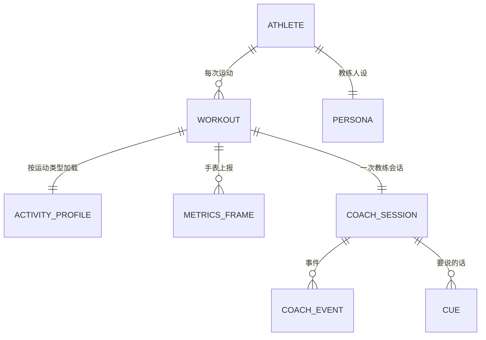

# coach-w 产品设计与技术架构

| | |
|---|---|
| 版本 | v0.1 |
| 日期 | 2026-11-21 |
| 状态 | 草案。M0 准备中（第 13 节）。 |

这是 coach-w 最核心的文档。产品范围、领域模型、架构、技术选型都以本文为准；改动这些内容时先改本文，再改代码。

## 1. coach-w 是什么

**一个一直在你身边的实时语音运动教练。** 手表看着你的身体，耳机里有人陪你说话。

用户戴着 Apple Watch、带着 iPhone、戴着耳机（首先是韶音骨传导）去运动。手表实时采集心率、配速、步频、功率、跑姿等指标，iPhone 把指标和用户的声音一起送到服务端的教练 Agent，教练用实时语音模型（首选 Qwen Realtime）在耳机里说话：给指令、纠正、鼓励，也能随时聊天、随时被打断。

目标体验：**像一个骑着电瓶车的教练一直在你边上**，看着你跑，知道什么时候该说话、什么时候该闭嘴。

### 1.1 三个核心点

1. **实时双工语音。** 不是"生成一句台词再播放"，而是像打电话一样的对话：用户随时插话，教练随时被打断，延迟以秒内为目标。
2. **数据驱动、不靠猜。** 教练说出的每个数字都来自手表数据（工具调用或注入的状态），模型不估计、不编造。
3. **通用内核，运动档案。** 数据通路、语音通路、教练编排与运动类型无关；每种运动的差异只写在运动档案（Activity Profile）里。跑步是主线，骑行、散步随后，其余 Apple 支持的运动由通用兜底档案覆盖。

### 1.2 一等对象是"这次运动"，教练是陪伴者

用户面对的是"今天这次 5 公里"和"我的教练"，不是"一个语音会话"。LiveKit 房间、模型会话、重连都是内部实现。会话断了可以重建，这次运动不能丢：运动数据以手表的 `HKWorkoutSession` 为准，语音中断不影响记录。

### 1.3 与同类项目的区别

| 项目 | 它是什么 | coach-w 的不同 |
|---|---|---|
| [aarc](https://github.com/alphato-o/aarc)（Apache-2.0） | iPhone + Watch 跑步 App，Claude 写台词、ElevenLabs 播放；回话走 Siri 转写 | 学它的编排（Director、优先级队列、过期丢弃、等音乐间隙）和"手表是唯一数据源"；但我们是实时双工语音，教练大脑在服务端，覆盖多种运动 |
| [pace-pilot](https://github.com/fabianferno/pace-pilot)（未声明许可） | iOS → WebRTC → Pipecat → Gemini Live 的跑步教练 | 架构最接近，学它"数据只能通过工具拿"和"运动中只开放少量工具"的思路；**未声明许可，不复制代码** |
| Apple 健身 / Workout App 自带提醒 | 阈值提醒、Pacer | 不能对话，不看趋势，没有人格 |

### 1.4 不做的事

- 自己做 STT → LLM → TTS 的级联作为默认实现。默认是原生 speech-to-speech 实时模型；级联只作为断网兜底或模型不支持时的降级。
- 游泳的实时语音（蓝牙在水下不可用），只做手表震动。
- 在客户端持有模型厂商的 API Key。
- 让模型自己决定什么时候主动说话（见 4.2）。
- 第一版不做账号体系、社交、排行榜、训练计划市场。

## 2. 用户旅程

1. 安装 iPhone App，手表上的 App 随之安装（watchOS App 打包在 iOS App 内）。首次打开授权 HealthKit、麦克风、定位。
2. 在 iPhone 上选运动类型（跑步 / 骑行 / 散步 / 其他）和今天的目标（轻松跑、配速 5'30"、心率不超过 Z3、只是随便走走聊聊）。
3. 点开始：iPhone 拉起手表 App 并开始 workout；同时加入语音房间，教练用一句话打招呼并确认目标。
4. 运动中：教练按阶段和节点陪跑，异常时主动提醒，用户随时说话。关键提醒同时在手表上震动。
5. 用户说"安静一会儿"或按耳机键，教练静音几分钟；紧急情况（心率过高）除外。
6. 结束：手表保存 workout 到 Apple 健康；教练做一句话总结；App 里留下本次的指标曲线和教练说过的话。

## 3. 领域模型



| 对象 | 含义 |
|---|---|
| **Athlete（运动者）** | 用户。年龄、最大心率、心率区间、习惯配速等。第一版存在 iPhone 本地，开始时随会话发给服务端。 |
| **Workout（运动）** | 一次运动，对应手表上的一个 `HKWorkoutSession`。有运动类型、目标、开始/暂停/结束状态。 |
| **Activity Profile（运动档案）** | 一种运动的教练定义：关心的指标和单位、阶段、事件规则、模式（教练 / 陪伴 / 引导）、说话频率、可用工具。见第 5 节。 |
| **Metrics Frame（指标帧）** | 手表每 1–2 秒发出的一帧原始指标。见 6.3。 |
| **Metrics State（指标状态）** | 服务端对指标帧的聚合：最新值、30 秒 / 2 分钟 / 全程窗口、趋势、分段。 |
| **Coach Event（事件）** | 由规则或导演产生的"值得说点什么"的事：心率超区间、整公里、半程、站住不动等。带类型、优先级、负载。 |
| **Cue（提示）** | 准备说出口的一条话：来源事件、优先级、冷却键、过期时间、是否允许打断、是否同时震动。 |
| **Coach Session（教练会话）** | 服务端一次 LiveKit 房间里的 Agent 会话，内部持有实时模型会话。可重建。 |
| **Persona（人设）** | 教练的性格与语气（严厉 / 温和 / 毒舌）、声音、话多话少。 |

## 4. 教练如何工作

### 4.1 分层

```text
MetricsFrame ─▶ MetricsState（多窗口趋势）
                    │
       ┌────────────┼──────────────┐
       ▼            ▼              ▼
  Director     EventEngine    Tools（get_metrics / adjust_target …）
 （阶段+节点）  （阈值+趋势）          ▲
       └─────┬──────┘                │
             ▼                       │
   CueQueue（优先级 / 冷却 / 过期 / 闭嘴规则）
             │                       │
             ▼                       │
   Realtime 模型会话 ─────────────────┘
  （把 cue 说自然 + 自由对话）
             │
             └─▶ 关键 cue 同时下发手表震动
```

### 4.2 原则：时机由确定性代码决定，表达交给模型

- **说不说、什么时候说**由 Director、EventEngine、CueQueue 决定，是可测试的普通代码。
- **怎么说**交给实时模型：CueQueue 放行一条 cue 时，调用 `generate_reply(instructions=...)`，指令里带上事实（"心率 178，已连续 25 秒高于 Z4 上限 172"）和语气要求，模型说成一句自然的话。
- **自由对话**是实时模型的正常行为。用户问数据时，模型必须调用工具（`get_metrics` 等），系统提示词里明确禁止估计数字。
- 每 30–60 秒向会话写入一条**不触发回复**的文本状态摘要，让对话时模型知道运动进行到哪里。

### 4.3 Director：一次运动的时间线

- 阶段由运动档案定义，例如跑步：准备 → 热身 → 主训练 → 放松 → 结束。
- 节点：开始、每公里（或每 N 分钟）分段、半程、最后一公里、结束。
- 节点之间的"陪伴"：按档案的间隔主动搭话，例如询问感受、谈话测试（"能说完整句子吗？"）。

### 4.4 EventEngine：看趋势，不看瞬时值

- 输入 MetricsState，输出 CoachEvent。规则写在运动档案里。
- 规则基于窗口而非单点，例如"心率连续 20 秒高于区间上限"、"最近 2 公里每公里掉速超过 10 秒"、"后半程触地时间比前半程增加 8%"。
- 传感器缺失时规则自动失效，不能产生误报（例如没有骑行功率计就没有功率规则）。

### 4.5 CueQueue：闭嘴比说话更难

- **优先级**：紧急（安全类，如心率过高）> 纠正 > 节点播报 > 陪伴闲聊。
- **冷却**：同一冷却键在冷却时间内不重复。
- **过期**：每条 cue 有过期时间，过期直接丢弃，不迟到播报（借鉴 aarc）。
- **不插话**：用户在说话时不放行非紧急 cue；教练正在说话时，只有紧急 cue 可以打断。
- **静音**：用户要求安静时，在静音时长内只放行紧急 cue。
- **密度**：状态平稳时拉长陪伴间隔；档案定义每分钟最多说几次。

### 4.6 三种模式

| 模式 | 适用 | 行为 |
|---|---|---|
| 教练 | 跑步、骑行 | 有目标，主动纠正和鼓励，节点播报完整 |
| 陪伴 | 散步、徒步 | 以自由聊天为主，偶尔报距离和时间，加安全关怀；几乎不纠正 |
| 引导 | 瑜伽、拉伸、冥想（后续） | 慢语速，按节奏带着做 |

### 4.7 工具

运动中只开放少量工具，降低延迟（pace-pilot 的经验）。通用工具：`get_metrics`、`get_progress`、`set_quiet(minutes)`、`end_workout_summary`。档案可增加自己的工具，例如跑步的 `adjust_target_pace`。

Qwen Realtime 的 function calling：`livekit-plugins-aliyun` 1.8.10 的源码里有工具转换、`update_tools` 和 `response.function_call_arguments.done` 处理，但端到端未实测（14.2）。不可用时退回"每次 cue 的指令里带上最新指标"。

## 5. 运动档案（Activity Profile）

### 5.1 结构

每个档案是一份声明式配置加少量代码，放在 `server/src/coachw/profiles/`：

- `activity_types`：对应的 `HKWorkoutActivityType`（如 `running`）。
- `mode`：教练 / 陪伴 / 引导。
- `metrics`：关心哪些指标、怎么读（跑步说"配速 5 分 30"，骑行说"时速 28"）。
- `phases`、`milestones`：Director 用。
- `rules`：EventEngine 用。
- `cadence`：陪伴间隔、每分钟最多几次。
- `tools`：额外工具。
- `prompt`：档案专属的系统提示片段。

**通用内核里不出现运动类型的分支判断**，差异全部在档案里。

### 5.2 首批档案

| 档案 | 优先级 | 指标 | 说明 |
|---|---|---|---|
| 跑步（室外 / 跑步机） | P0 | 心率、配速、距离、步频、功率、步幅、触地时间、垂直振幅、GPS、海拔 | Apple Watch SE（第二代）官方规格列出步幅、触地时间、垂直振幅；跑步功率待实测（14.2） |
| 散步 / 徒步 | P1 | 心率、配速、距离、步数、海拔 | 陪伴模式，最容易做好 |
| 骑行（室外 / 室内） | P1 | 心率、速度、距离、海拔；踏频和功率需要蓝牙传感器 | 语音要短；路上安全优先 |
| 通用兜底 | P1 | 心率、时长、卡路里 | 覆盖其余所有类型，陪伴模式 |
| 力量 / HIIT | P2 | 心率 | 只能按组间休息和心率引导 |
| 游泳 | 不做语音 | — | 只做手表震动 |

## 6. 数据通路

### 6.1 手表：唯一的运动数据源

- watchOS App 运行 `HKWorkoutSession` + `HKLiveWorkoutBuilder`，用 `HKLiveWorkoutDataSource` 按运动类型自动采集。
- workout 结束时由手表保存到 Apple 健康。
- iPhone 不另起一份 workout，不另行计算距离（避免两套数字）。iPhone 单独运动（不戴手表）作为后续选项。

### 6.2 手表 → iPhone

- 首选 **HealthKit 镜像 workout 会话**（iOS 17 / watchOS 10 起）：iPhone 用 `startWatchApp(with:)` 拉起手表 App；手表 `startMirroringToCompanionDevice()`；iPhone 在 `workoutSessionMirroringStartHandler` 里接住会话；双方用 `sendToRemoteWorkoutSession(data:)` 双向传数据。镜像会话也让 iPhone App 在后台保持运行（待实测，14.2）。
- 备选：`WatchConnectivity`。
- 代码起点：Apple 示例 [Building a multidevice workout app](https://developer.apple.com/documentation/healthkit/building-a-multidevice-workout-app)（WWDC23 10023）。

### 6.3 线协议 v1

指标帧、提示和控制消息都用 JSON，带版本号 `v`。iPhone 收到手表的帧后补上 `phone_ts` 转发给服务端，不改字段含义。

`coach.metrics`（手表 → iPhone → 服务端）：

```json
{
  "v": 1,
  "seq": 128,
  "ts": 1763726400123,
  "activity": "running",
  "state": "running",
  "elapsed_s": 642.5,
  "hr_bpm": 152,
  "distance_m": 2034.1,
  "speed_mps": 3.21,
  "cadence_spm": 172,
  "power_w": 245,
  "stride_m": 1.12,
  "gct_ms": 248,
  "vo_cm": 8.4,
  "energy_kcal": 168.2,
  "lat": 39.9042,
  "lon": 116.4074,
  "alt_m": 45.2
}
```

- 除 `v`、`seq`、`ts`、`activity`、`state`、`elapsed_s` 外都可缺省；缺省表示"这次没有"，不是 0。
- `state`：`running` / `paused` / `ended`（指 workout 状态，与运动类型无关）。
- `ts`：手表的 Unix 毫秒时间。
- 规范样例在 `protocol/fixtures/`，Swift（`CoachKit`）和 Python（`coachw.protocol`）的测试都解析同一份样例。**改协议时三处同一次提交改。**

`coach.cue`（服务端 → iPhone → 手表）与 `coach.control`（双向：开始、暂停、结束、静音）在 M3 定义。

### 6.4 iPhone → 服务端

指标帧走 LiveKit data channel，topic 即 `coach.metrics`，可靠传输。iPhone 本地按 1 秒节流。

## 7. 语音通路

### 7.1 链路

```text
韶音耳机 ⇄ iPhone（AVAudioSession + LiveKit Swift SDK）
          ⇅ WebRTC（音频轨 + data channel）
LiveKit Server（自部署）
          ⇅
Python Agent Worker（LiveKit Agents）⇄ Qwen Realtime（DashScope WebSocket）
```

- 复用 voicelab 已跑通的链路（维护者本地仓库 `~/voicelab/voice-playground`，未公开）：`livekit-agents` 1.8.10 + `livekit-plugins-aliyun` 1.8.10，模型 `qwen-audio-3.1-realtime-flash`。
- 转向检测默认 `server_vad`。voicelab 实测：`smart_turn` 下打断要约 5 秒才生效，`server_vad` 约 0.5 秒。
- iOS 不直连 Qwen，不持有模型 Key；token 由服务端签发，限定房间和 Agent。

### 7.2 音频与耳机

- `AVAudioSession` 用 `playAndRecord` + 允许蓝牙（HFP）以使用耳机麦克风。HFP 下音质降为窄带单声道，对语音足够，音乐会变差。备选：手机麦克风 + A2DP 输出（风噪大）。待户外实测（14.2）。
- 教练说话时压低音乐（`duckOthers`），说完恢复。
- iOS 开启 `audio` 后台模式；锁屏下持续运行依赖后台音频 + 镜像 workout 会话。
- 风噪与喘息可能误触发 VAD。兜底：按键说话（耳机多功能键 `MPRemoteCommandCenter`，或手表按钮）。

### 7.3 断网兜底

- 网络断开时语音会话中断，运动记录不受影响（在手表上）。
- iPhone 本地用 `AVSpeechSynthesizer` 播报紧急类和节点类 cue 的模板文本（由本地规则产生），手表震动照常。
- 网络恢复后自动重连，新会话带上当前状态摘要。

## 8. 整体架构

```text
┌──── Apple Watch（watchOS App）────┐
│ HKWorkoutSession / LiveBuilder   │
│ 指标帧、震动、抬腕显示              │
└──────────────┬───────────────────┘
               │ 镜像 workout 会话
┌──────────────▼───────────────────┐
│ iPhone（iOS App）                 │
│ 协议转发、音频会话、LiveKit 客户端    │
│ 本地兜底播报、运动记录界面            │
└──────────────┬───────────────────┘
               │ HTTPS（token）/ WebRTC
┌──────────────▼───────────────────┐
│ 服务端（一台云主机，docker compose） │
│ Caddy（TLS）· LiveKit Server        │
│ coachw api（签发 token）            │
│ coachw agent（教练大脑）             │
└──────────────┬───────────────────┘
               │
         DashScope（Qwen Realtime）
```

### 8.1 可靠性

- 运动数据以手表为准，服务端和语音的任何故障都不能丢运动记录。
- 服务端的教练状态是内存态，会话重建时由 iPhone 重新上报当前状态摘要恢复。
- 迟到的 cue 不播（过期丢弃）。

## 9. 技术选型

### 9.1 语言

| 部分 | 选型 | 理由 |
|---|---|---|
| iOS + watchOS | **Swift 6 + SwiftUI** | HealthKit workout、镜像会话、watchOS 只能用原生 |
| 共享 Swift 逻辑 | **SwiftPM 包 `CoachKit`** | 协议模型和纯逻辑，`swift test` 可在命令行测试，不依赖模拟器 |
| Xcode 工程 | **XcodeGen**（`project.yml`） | 工程文件可读、可 diff，coding agent 能改；`.xcodeproj` 不入库 |
| 服务端 | **Python 3.12 + uv** | LiveKit Agents 的 Python SDK 最成熟；直接复用 voicelab |
| token API | Python（与 agent 同一个包，FastAPI，M2 引入） | 服务端只有一种语言 |
| 部署 | docker compose + Caddy | 单机足够 |

### 9.2 工具链

- Swift：`swift test`（CoachKit）、`xcodebuild`（App，M1 起）；格式用 Xcode 自带的 `swift format`（M1 时确认版本后启用）。
- Python：`uv`、`ruff`（lint + format）、`pytest`。
- CI：GitHub Actions，`server` 在 Ubuntu 上跑，`CoachKit` 在 macOS 上跑。

### 9.3 代码结构

```text
apple/
  CoachKit/          SwiftPM 包：线协议、档案无关的纯逻辑，iOS 和 watchOS 共用
  project.yml        XcodeGen 工程定义（M1）
  iOS/               iPhone App（M1）
  Watch/             watchOS App（M1）
server/
  src/coachw/
    protocol.py      线协议 v1
    agent/           LiveKit Agent 入口（M2）
    api/             token 签发（M2）
    coach/           MetricsState、Director、EventEngine、CueQueue（M3）
    profiles/        运动档案（M3）
    providers/       实时模型适配（M2，从 voicelab 迁移）
  tests/
protocol/fixtures/   线协议规范样例，两端测试共用
deploy/              docker compose、Caddy、LiveKit 配置（M2）
spikes/              技术验证脚本，不属于产品代码
docs/                文档
```

### 9.4 AirBuild 等 AI App 构建平台

不用于开发。[AirBuild](https://air.build/) 是"AI 团队生成原生 iOS App + 自动处理 App Review"的平台（候补名单制）。我们的难点在 watchOS 镜像会话、实时语音和 Python 服务端，它不覆盖；开发流程已用 Multica + coding agent。上架 App Store 时可以再评估它的 App Review / TestFlight / ASO 自动化。

## 10. 部署

- 一台云主机（2 核 4G 起），公网 IP，一个域名。
- 地域：中国内地服务器用域名对外提供 80/443 服务需 ICP 备案；未备案时选香港。DashScope 走北京节点。
- 端口：443/TCP（Caddy + LiveKit 信令），7881/TCP（WebRTC over TCP），50000–60000/UDP（媒体），3478/UDP（TURN）。以 LiveKit 官方部署文档为准，部署时核对。
- 密钥（LiveKit API secret、DashScope key）只放服务器环境变量，不入库。

## 11. 隐私与密钥

- 心率、位置是健康和隐私数据。服务端只在会话内存里使用，第一版不持久化；日志里不打指标原值和坐标。
- 客户端不持有模型 Key。LiveKit token 短期有效、限定房间。
- 仓库公开：不提交任何凭据、`.env`、个人数据、真实运动记录。测试样例使用合成数据。

## 12. 参考项目与许可

| 项目 | 许可 | 用法 |
|---|---|---|
| Apple 示例 multidevice workout | 以示例包内的 LICENSE 为准 | 复制作为 M1 工程骨架，保留其许可说明 |
| voicelab | 本人代码 | 迁移 Qwen 适配与 Agent 骨架 |
| aarc | Apache-2.0 | 学设计；逐字移植文件时保留版权头并写入 `NOTICE` |
| pace-pilot | 未声明 | 只学思路，不复制代码 |

本仓库许可：Apache-2.0。

## 13. 里程碑

| 阶段 | 内容 | 完成标志 |
|---|---|---|
| **M0 准备** | 仓库、文档、协议 v1、CI；开发账号、服务器、域名、Key（见 `docs/setup.md`） | `docs/setup.md` 清单全部打勾 |
| **M1 数据通路** | 基于 Apple 示例的 iOS + watchOS App，镜像会话，iPhone 实时显示指标帧 | 真机跑一次 1 公里：iPhone 锁屏也持续收到 ≥1 Hz 心率和配速 |
| **M2 语音通路** | 服务端部署（LiveKit + agent + token API），iOS 接入 LiveKit，耳机对话 | 户外戴韶音边走边和教练聊天，可打断 |
| **M3 教练大脑** | MetricsState、Director、EventEngine、CueQueue、跑步档案、工具、手表震动 | 真实 5 公里：分段播报、超心率提醒、问配速答得对 |
| **M4 扩展** | 散步、骑行、通用兜底档案；断网兜底；跑后总结 | 三种运动各实测一次 |

### 13.1 M0 进度

| 项 | 状态 |
|---|---|
| 仓库、许可、AGENTS.md、spec | 完成 |
| 线协议 v1 + 两端解析测试 | 完成 |
| CI | 完成 |
| 准备清单（`docs/setup.md`） | 进行中 |

## 14. 验证记录

### 14.1 已实测

| 项 | 结论 |
|---|---|
| LiveKit + Qwen Realtime（voicelab，浏览器端） | 通过（2026-11-09）。`server_vad` 打断约 0.5 秒；`smart_turn` 约 5 秒 |

### 14.2 仍待验证

- Apple Watch SE（第二代）在 workout 中是否提供跑步功率。
- 镜像 workout 会话下，iPhone 锁屏后 App 是否持续运行并接收数据。
- 指标帧实际频率（心率、配速的更新间隔）。
- Qwen Realtime 经 `livekit-plugins-aliyun` 的 function calling 端到端是否可用。
- `generate_reply(instructions=...)` 在 Qwen 插件下打断与排队行为。
- 韶音耳机 HFP 模式下的户外收音质量、风噪对 `server_vad` 的影响。
- LiveKit Swift SDK 与后台音频、蓝牙路由切换的兼容性。
- 4G/5G 移动网络下的端到端延迟。

## 15. 未决问题

- 用户手表与 iPhone 的系统版本（决定最低部署版本，当前暂定 iOS 18 / watchOS 11）。
- 服务器地域（香港 / 北京）与域名。
- 音乐播放与教练说话的协调方式（压低 / 暂停 / 等间隙）。
- 运动后记录存哪里（仅本机 / Apple 健康 / 服务端）。
