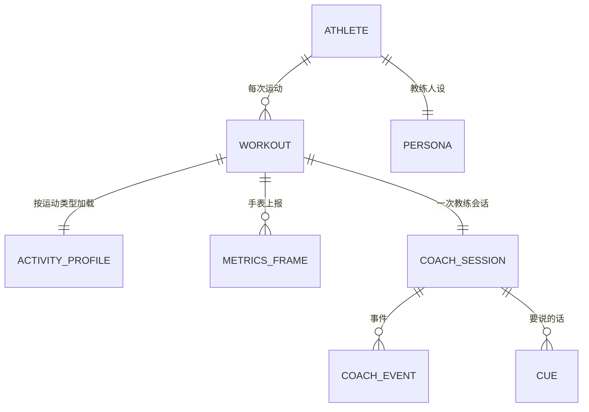

# coach-w 产品设计与技术架构

| | |
|---|---|
| 版本 | v0.1 |
| 日期 | 2026-11-21 |
| 状态 | 草案。M1 待真机验收；M2 服务端已在本机跑通，iOS 接入未开始（第 13 节）。 |

这是 coach-w 最核心的文档。产品范围、领域模型、架构、技术选型都以本文为准；改动这些内容时先改本文，再改代码。

## 1. coach-w 是什么

**一个一直在你身边的实时语音运动教练。** 手表看着你的身体，耳机里有人陪你说话。

用户戴着 Apple Watch、带着 iPhone、戴着耳机（首先是韶音骨传导）去运动。手表实时采集心率、配速、步频、功率、跑姿等指标，iPhone 把指标和用户的声音一起送到服务端的教练 Agent，教练用实时语音模型（首选 Qwen Realtime）在耳机里说话：给指令、纠正、鼓励，也能随时聊天、随时被打断。

目标体验：**像一个骑着电瓶车的教练一直在你边上**，看着你跑，知道什么时候该说话、什么时候该闭嘴。

### 1.1 三个核心点

1. **实时双工语音。** 不是"生成一句台词再播放"，而是像打电话一样的对话：用户随时插话，教练随时被打断，延迟以秒内为目标。
2. **数据驱动、不靠猜。** 教练说出的每个数字都来自手表数据（工具调用或注入的状态），模型不估计、不编造。
3. **通用内核，运动档案。** 数据通路、语音通路、教练编排与运动类型无关；每种运动的差异只写在运动档案（Activity Profile）里。跑步是主线，骑行、散步随后，其余 Apple 支持的运动由通用兜底档案覆盖。

### 1.2 一等对象是"这次运动"，教练是陪伴者

用户面对的是"今天这次 5 公里"和"我的教练"，不是"一个语音会话"。LiveKit 房间、模型会话、重连都是内部实现。会话断了可以重建，这次运动不能丢：运动数据以手表的 `HKWorkoutSession` 为准，语音中断不影响记录。

### 1.3 与同类项目的区别

| 项目 | 它是什么 | coach-w 的不同 |
|---|---|---|
| [aarc](https://github.com/alphato-o/aarc)（Apache-2.0） | iPhone + Watch 跑步 App，Claude 写台词、ElevenLabs 播放；回话走 Siri 转写 | 学它的编排（Director、优先级队列、过期丢弃、等音乐间隙）和"手表是唯一数据源"；但我们是实时双工语音，教练大脑在服务端，覆盖多种运动 |
| [pace-pilot](https://github.com/fabianferno/pace-pilot)（未声明许可） | iOS → WebRTC → Pipecat → Gemini Live 的跑步教练 | 架构最接近，学它"数据只能通过工具拿"和"运动中只开放少量工具"的思路；**未声明许可，不复制代码** |
| Apple 健身 / Workout App 自带提醒 | 阈值提醒、Pacer | 不能对话，不看趋势，没有人格 |

### 1.4 不做的事

- 自己做 STT → LLM → TTS 的级联作为默认实现。默认是原生 speech-to-speech 实时模型；级联只作为断网兜底或模型不支持时的降级。
- 游泳的实时语音（蓝牙在水下不可用），只做手表震动。
- 在客户端持有模型厂商的 API Key。
- 让模型自己决定什么时候主动说话（见 4.2）。
- 第一版不做账号体系、社交、排行榜、训练计划市场。

## 2. 用户旅程

1. 安装 iPhone App，手表上的 App 随之安装（watchOS App 打包在 iOS App 内）。首次打开授权 HealthKit、麦克风、定位。
2. 在 iPhone 上选运动类型（跑步 / 骑行 / 散步 / 其他）和今天的目标（轻松跑、配速 5'30"、心率不超过 Z3、只是随便走走聊聊）。
3. 点开始：iPhone 拉起手表 App 并开始 workout；同时加入语音房间，教练用一句话打招呼并确认目标。
4. 运动中：教练按阶段和节点陪跑，异常时主动提醒，用户随时说话。关键提醒同时在手表上震动。
5. 用户说"安静一会儿"或按耳机键，教练静音几分钟；紧急情况（心率过高）除外。
6. 结束：手表保存 workout 到 Apple 健康；教练做一句话总结；App 里留下本次的指标曲线和教练说过的话。

## 3. 领域模型



| 对象 | 含义 |
|---|---|
| **Athlete（运动者）** | 用户。年龄、最大心率、心率区间、习惯配速等。第一版存在 iPhone 本地，开始时随会话发给服务端。 |
| **Workout（运动）** | 一次运动，对应手表上的一个 `HKWorkoutSession`。有运动类型、目标、开始/暂停/结束状态。 |
| **Activity Profile（运动档案）** | 一种运动的教练定义：关心的指标和单位、阶段、事件规则、模式（教练 / 陪伴 / 引导）、说话频率、可用工具。见第 5 节。 |
| **Metrics Frame（指标帧）** | 手表每 1–2 秒发出的一帧原始指标。见 6.3。 |
| **Metrics State（指标状态）** | 服务端对指标帧的聚合：最新值、30 秒 / 2 分钟 / 全程窗口、趋势、分段。 |
| **Coach Event（事件）** | 由规则或导演产生的"值得说点什么"的事：心率超区间、整公里、半程、站住不动等。带类型、优先级、负载。 |
| **Cue（提示）** | 准备说出口的一条话：来源事件、优先级、冷却键、过期时间、是否允许打断、是否同时震动。 |
| **Coach Session（教练会话）** | 服务端一次 LiveKit 房间里的 Agent 会话，内部持有实时模型会话。可重建。 |
| **Persona（人设）** | 教练的性格与语气（严厉 / 温和 / 毒舌）、声音、话多话少。 |

### 3.1 用户与扩展

目标是以后像 Keep 一样开放注册，但现在只有维护者和几个朋友用。原则：**留好接缝，不提前建系统。**

**现在（M2 起，邀请制）：**

- 每台 iPhone 首次启动生成一个 `athlete_id`（UUID，存 Keychain）。运动者资料（最大心率、心率区间、习惯配速）存在手机上，开始运动时随会话发给服务端。
- token API 用**邀请码**换 LiveKit token：服务端环境变量里配一组邀请码，每个码对应一个人（名字和每日语音分钟上限）。不建数据库。
- 服务端教练状态只在会话内存里，按 `athlete_id` 区分；日志只记 `athlete_id`，不记名字。
- 每日语音分钟上限从第一天就有：实时语音模型按时长计费，朋友用也要防止意外超支。

**M2 的实现（`server/src/coachw/api/`）：**

- 邀请码在环境变量 `COACHW_INVITES`：逗号分隔的 `code:name:daily_minutes`，码至少 12 个字符。比较用常量时间。名字只给运维看，不进日志、不进 token、不发给 Agent。
- `POST /v1/session`，请求体 `{invite_code, athlete_id}`（`athlete_id` 必须是 UUID）。成功返回 `{server_url, room, token, token_expires_at, max_session_s}`；未知邀请码 401，`athlete_id` 不合法 422，当日分钟不足 429（见下）。
- token：每次新建一个房间 `coach-<随机>`，只能加入这个房间；identity 是 `athlete_id`；有效期 `COACHW_TOKEN_TTL_S`（默认 10 分钟，只管"多久内能加入"）；房间配置里 dispatch 教练 Agent（`coach-w`），最多 2 个参与者。participant metadata 里签入 `{athlete_id, max_session_s}`，客户端改不了。
- 分钟上限按邀请码（即按人）计，"一天"按 `COACHW_QUOTA_TZ`（默认 Asia/Shanghai）。签发 token 时预占本次会话上限 `min(当日剩余, COACHW_SESSION_MAX_MINUTES)`，剩余不足 `COACHW_MIN_SESSION_S`（默认 60 秒）时返回 429。LiveKit webhook（`participant_joined` / `participant_left`，只在本机回环地址可达）把预占结算成实际在房间里的时长；token 过期仍未加入的预占自动释放。并发拿多个 token 也不会超额。
- 会话时长上限由 Agent 执行：到 `max_session_s` 时说一句告别，然后删除房间。
- **计数只在 API 进程内存里，进程重启当日用量清零。** 几个人用时可以接受；开放注册时随账号表一起换成数据库。

**必须守住的接缝：**

- 服务端所有接口和会话都带 `athlete_id`，不出现"只有一个用户"的假设（全局单例状态、写死的个人参数）。
- 运动者资料是会话的输入，不写死在提示词或代码里。
- 邀请码校验集中在 token API 一处，以后整体换成正式登录。

**以后（开放注册时）：**

- 用 Sign in with Apple 换掉邀请码，服务端加账号表（届时再选数据库）。
- 运动历史和教练记忆在用户同意后同步到服务端。
- 按账号做配额和计费。

## 4. 教练如何工作

### 4.1 分层

```text
MetricsFrame ─▶ MetricsState（多窗口趋势）
                    │
       ┌────────────┼──────────────┐
       ▼            ▼              ▼
  Director     EventEngine    Tools（get_metrics / adjust_target …）
 （阶段+节点）  （阈值+趋势）          ▲
       └─────┬──────┘                │
             ▼                       │
   CueQueue（优先级 / 冷却 / 过期 / 闭嘴规则）
             │                       │
             ▼                       │
   Realtime 模型会话 ─────────────────┘
  （把 cue 说自然 + 自由对话）
             │
             └─▶ 关键 cue 同时下发手表震动
```

### 4.2 原则：时机由确定性代码决定，表达交给模型

- **说不说、什么时候说**由 Director、EventEngine、CueQueue 决定，是可测试的普通代码。
- **怎么说**交给实时模型：CueQueue 放行一条 cue 时，调用 `generate_reply(instructions=...)`，指令里带上事实（"心率 178，已连续 25 秒高于 Z4 上限 172"）和语气要求，模型说成一句自然的话。
- **自由对话**是实时模型的正常行为。用户问数据时，模型必须调用工具（`get_metrics` 等），系统提示词里明确禁止估计数字。
- 每 30–60 秒向会话写入一条**不触发回复**的文本状态摘要，让对话时模型知道运动进行到哪里。

### 4.3 Director：一次运动的时间线

- 阶段由运动档案定义，例如跑步：准备 → 热身 → 主训练 → 放松 → 结束。
- 节点：开始、每公里（或每 N 分钟）分段、半程、最后一公里、结束。
- 节点之间的"陪伴"：按档案的间隔主动搭话，例如询问感受、谈话测试（"能说完整句子吗？"）。

### 4.4 EventEngine：看趋势，不看瞬时值

- 输入 MetricsState，输出 CoachEvent。规则写在运动档案里。
- 规则基于窗口而非单点，例如"心率连续 20 秒高于区间上限"、"最近 2 公里每公里掉速超过 10 秒"、"后半程触地时间比前半程增加 8%"。
- 传感器缺失时规则自动失效，不能产生误报（例如没有骑行功率计就没有功率规则）。

### 4.5 CueQueue：闭嘴比说话更难

- **优先级**：紧急（安全类，如心率过高）> 纠正 > 节点播报 > 陪伴闲聊。
- **冷却**：同一冷却键在冷却时间内不重复。
- **过期**：每条 cue 有过期时间，过期直接丢弃，不迟到播报（借鉴 aarc）。
- **不插话**：用户在说话时不放行非紧急 cue；教练正在说话时，只有紧急 cue 可以打断。
- **静音**：用户要求安静时，在静音时长内只放行紧急 cue。
- **密度**：状态平稳时拉长陪伴间隔；档案定义每分钟最多说几次。

### 4.6 三种模式

| 模式 | 适用 | 行为 |
|---|---|---|
| 教练 | 跑步、骑行 | 有目标，主动纠正和鼓励，节点播报完整 |
| 陪伴 | 散步、徒步 | 以自由聊天为主，偶尔报距离和时间，加安全关怀；几乎不纠正 |
| 引导 | 瑜伽、拉伸、冥想（后续） | 慢语速，按节奏带着做 |

### 4.7 工具

运动中只开放少量工具，降低延迟（pace-pilot 的经验）。通用工具：`get_metrics`、`get_progress`、`set_quiet(minutes)`、`end_workout_summary`。档案可增加自己的工具，例如跑步的 `adjust_target_pace`。

Qwen Realtime 的 function calling 经 `livekit-plugins-aliyun` 1.8.10 端到端可用（14.1），但插件有一个缺陷要绕开：Qwen 常在用户这句话的转写到达之前就调用工具，插件在工具返回后同步上下文时，把这条还没有文字的语音消息当成空消息**从服务端会话里删掉**，模型随后回答的是更早的一条文字消息（实测表现为重复开场白或答非所问）。`coachw.providers.qwen` 在同步时保留这类待转写的用户消息，修复后连续 3 轮冒烟全部答对。升级插件时先跑冒烟（7.2），确认问题是否已在上游修复。

工具结果以 JSON 字符串返回（框架会把非字符串结果 `str()` 成 Python 表示）。不可用时的退路仍是"每次 cue 的指令里带上最新指标"。

## 5. 运动档案（Activity Profile）

### 5.1 结构

每个档案是一份声明式配置加少量代码，放在 `server/src/coachw/profiles/`：

- `activity_types`：对应的 `HKWorkoutActivityType`（如 `running`）。
- `mode`：教练 / 陪伴 / 引导。
- `metrics`：关心哪些指标、怎么读（跑步说"配速 5 分 30"，骑行说"时速 28"）。
- `phases`、`milestones`：Director 用。
- `rules`：EventEngine 用。
- `cadence`：陪伴间隔、每分钟最多几次。
- `tools`：额外工具。
- `prompt`：档案专属的系统提示片段。

**通用内核里不出现运动类型的分支判断**，差异全部在档案里。

### 5.2 首批档案

| 档案 | 优先级 | 指标 | 说明 |
|---|---|---|---|
| 跑步（室外 / 跑步机） | P0 | 心率、配速、距离、步频、功率、步幅、触地时间、垂直振幅、GPS、海拔 | 维护者的手表是 Apple Watch Series 8（watchOS 26.6.1），支持跑步功率和跑姿指标；实际上报情况待实测（14.2） |
| 散步 / 徒步 | P1 | 心率、配速、距离、步数、海拔 | 陪伴模式，最容易做好 |
| 骑行（室外 / 室内） | P1 | 心率、速度、距离、海拔；踏频和功率需要蓝牙传感器 | 语音要短；路上安全优先 |
| 通用兜底 | P1 | 心率、时长、卡路里 | 覆盖其余所有类型，陪伴模式 |
| 力量 / HIIT | P2 | 心率 | 只能按组间休息和心率引导 |
| 游泳 | 不做语音 | — | 只做手表震动 |

## 6. 数据通路

### 6.1 手表：唯一的运动数据源

- watchOS App 运行 `HKWorkoutSession` + `HKLiveWorkoutBuilder`，用 `HKLiveWorkoutDataSource` 按运动类型自动采集。
- workout 结束时由手表保存到 Apple 健康。
- iPhone 不另起一份 workout，不另行计算距离（避免两套数字）。iPhone 单独运动（不戴手表）作为后续选项。

### 6.2 手表 → iPhone

- 首选 **HealthKit 镜像 workout 会话**（iOS 17 / watchOS 10 起）：iPhone 用 `startWatchApp(toHandle:)` 拉起手表 App；手表 `startMirroringToCompanionDevice()`；iPhone 在 `workoutSessionMirroringStartHandler` 里接住会话；双方用 `sendToRemoteWorkoutSession(data:)` 双向传数据。镜像会话也让 iPhone App 在后台保持运行（待实测，14.2）。
- 备选：`WatchConnectivity`。
- 参考：Apple 示例 [Building a multidevice workout app](https://developer.apple.com/documentation/healthkit/building-a-multidevice-workout-app)（WWDC23 10023，MIT 许可）。M1 按它的结构重写，没有逐字复制文件。
- 实现：手表 `apple/Watch/WorkoutController.swift`（主会话、采集、发帧），iPhone `apple/iOS/MirrorReceiver.swift`（接镜像会话、解帧、统计）。读数换算成线协议单位、节流（最多 1 帧/秒，状态变化立即发）、由步数推算步频都在 `CoachKit.FrameBuilder`，命令行可测。运动进行中手表每秒发一帧心跳（没有新读数也发），保证时长持续更新；这样收不到帧就能判断为链路断开，而不是"暂时没有新数据"。首次真机运行时只靠 HealthKit 回调驱动，平均间隔为 1.82 秒，所以加了心跳。
- 步频：HealthKit 的跑步数据没有直接的步频类型，步行类运动由累计步数在 15 秒窗口内推算；骑行用传感器的 `cyclingCadence`。
- 手机端统计在 `CoachKit.FrameStats`：收到、丢失、乱序帧数，平均间隔，最近一帧的手机与手表时间差（包含时钟偏差）。界面上的"数据流"一节用来回答 14.2 的频率和后台问题。

### 6.3 线协议 v1

指标帧、提示和控制消息都用 JSON，带版本号 `v`。iPhone 收到手表的帧后补上 `phone_ts` 转发给服务端，不改字段含义。

`coach.metrics`（手表 → iPhone → 服务端）：

```json
{
  "v": 1,
  "seq": 128,
  "ts": 1763726400123,
  "activity": "running",
  "state": "running",
  "elapsed_s": 642.5,
  "hr_bpm": 152,
  "distance_m": 2034.1,
  "speed_mps": 3.21,
  "cadence_spm": 172,
  "power_w": 245,
  "stride_m": 1.12,
  "gct_ms": 248,
  "vo_cm": 8.4,
  "energy_kcal": 168.2,
  "lat": 39.9042,
  "lon": 116.4074,
  "alt_m": 45.2
}
```

- 除 `v`、`seq`、`ts`、`activity`、`state`、`elapsed_s` 外都可缺省；缺省表示"这次没有"，不是 0。
- `state`：`running` / `paused` / `ended`（指 workout 状态，与运动类型无关）。
- `ts`：手表的 Unix 毫秒时间。
- 规范样例在 `protocol/fixtures/`，Swift（`CoachKit`）和 Python（`coachw.protocol`）的测试都解析同一份样例。**改协议时三处同一次提交改。**

`coach.cue`（服务端 → iPhone → 手表）与 `coach.control`（双向：开始、暂停、结束、静音）在 M3 定义。

### 6.4 iPhone → 服务端

指标帧走 LiveKit data channel，topic 即 `coach.metrics`，可靠传输。iPhone 本地按 1 秒节流。

## 7. 语音通路

### 7.1 链路

```text
韶音耳机 ⇄ iPhone（AVAudioSession + LiveKit Swift SDK）
          ⇅ WebRTC（音频轨 + data channel）
LiveKit Server（自部署）
          ⇅
Python Agent Worker（LiveKit Agents）⇄ Qwen Realtime（DashScope WebSocket）
```

- 复用 voicelab 已跑通的链路（维护者本地仓库 `~/voicelab/voice-playground`，未公开）：`livekit-agents` 1.8.10 + `livekit-plugins-aliyun` 1.8.10，模型 `qwen-audio-3.1-realtime-flash`。
- 转向检测默认 `server_vad`。voicelab 实测：`smart_turn` 下打断要约 5 秒才生效，`server_vad` 约 0.5 秒。
- iOS 不直连 Qwen，不持有模型 Key；token 由服务端签发，限定房间和 Agent。

### 7.2 服务端实现（M2）

- 教练 Agent：`server/src/coachw/agent/`。`worker.py` 是 `AgentServer` 入口（`python -m coachw.agent dev|start`），每个房间一个会话；`coach.py` 是系统提示词和工具；`metrics.py` 保存本会话最新一帧。
- Agent 只接受房间里那位运动者（token 的 identity）在 `coach.metrics` 上发的帧，用 `MetricsFrame` 解析；坏帧丢弃并只记错误类型。按 `(ts, seq)` 只保留更新的帧，迟到的帧不覆盖。
- `get_metrics` 返回最新一帧里有的指标、`age_s` 和换算好的 `pace_per_km`；超过 10 秒没有新帧时返回 `available: false`。坐标不给模型。缺省的指标不出现，不报 0。
- 实时模型由 `coachw.providers.get_realtime_model(name)` 创建，`COACHW_PROVIDER` 默认 `qwen`；插件只在 `providers/` 里引用。
- 同一主机预热的空闲进程数 `COACHW_AGENT_IDLE_PROCESSES`（默认 2；LiveKit 生产默认 8，2 核 4G 吃不消）；进程初始化超时放宽到 30 秒（负载高时默认 10 秒不够，实测会导致派单失败）。
- 本机一条命令起全套：`./scripts/dev.sh`（LiveKit 二进制 + token API + Agent，日志在 `logs/`）。端到端冒烟：`server/tests/e2e/smoke_voice.py`，用 macOS `say` 提问，用合成指标帧，检查回答里的数字来自工具。

### 7.3 音频与耳机

- `AVAudioSession` 用 `playAndRecord` + 允许蓝牙（HFP）以使用耳机麦克风。HFP 下音质降为窄带单声道，对语音足够，音乐会变差。备选：手机麦克风 + A2DP 输出（风噪大）。待户外实测（14.2）。
- 教练说话时压低音乐（`duckOthers`），说完恢复。
- iOS 开启 `audio` 后台模式；锁屏下持续运行依赖后台音频 + 镜像 workout 会话。
- 风噪与喘息可能误触发 VAD。兜底：按键说话（耳机多功能键 `MPRemoteCommandCenter`，或手表按钮）。

### 7.4 断网兜底

- 网络断开时语音会话中断，运动记录不受影响（在手表上）。
- iPhone 本地用 `AVSpeechSynthesizer` 播报紧急类和节点类 cue 的模板文本（由本地规则产生），手表震动照常。
- 网络恢复后自动重连，新会话带上当前状态摘要。

## 8. 整体架构

```text
┌──── Apple Watch（watchOS App）────┐
│ HKWorkoutSession / LiveBuilder   │
│ 指标帧、震动、抬腕显示              │
└──────────────┬───────────────────┘
               │ 镜像 workout 会话
┌──────────────▼───────────────────┐
│ iPhone（iOS App）                 │
│ 协议转发、音频会话、LiveKit 客户端    │
│ 本地兜底播报、运动记录界面            │
└──────────────┬───────────────────┘
               │ HTTPS（token）/ WebRTC
┌──────────────▼───────────────────┐
│ 服务端（一台云主机，docker compose） │
│ Caddy（TLS）· LiveKit Server        │
│ coachw api（签发 token）            │
│ coachw agent（教练大脑）             │
└──────────────┬───────────────────┘
               │
         DashScope（Qwen Realtime）
```

### 8.1 可靠性

- 运动数据以手表为准，服务端和语音的任何故障都不能丢运动记录。
- 服务端的教练状态是内存态，会话重建时由 iPhone 重新上报当前状态摘要恢复。
- 迟到的 cue 不播（过期丢弃）。

## 9. 技术选型

### 9.1 语言

| 部分 | 选型 | 理由 |
|---|---|---|
| iOS + watchOS | **Swift 6 + SwiftUI** | HealthKit workout、镜像会话、watchOS 只能用原生 |
| 共享 Swift 逻辑 | **SwiftPM 包 `CoachKit`** | 协议模型和纯逻辑，`swift test` 可在命令行测试，不依赖模拟器 |
| Xcode 工程 | **XcodeGen**（`project.yml`） | 工程文件可读、可 diff，coding agent 能改；`.xcodeproj` 不入库 |
| 服务端 | **Python 3.12 + uv** | LiveKit Agents 的 Python SDK 最成熟；直接复用 voicelab |
| token API | Python（与 agent 同一个包，FastAPI，M2 引入） | 服务端只有一种语言 |
| 部署 | docker compose + Caddy | 单机足够 |

### 9.2 工具链

- Swift：`swift test`（CoachKit）、`xcodebuild`（App，M1 起）；格式用 Xcode 自带的 `swift format`（M1 时确认版本后启用）。
- Python：`uv`、`ruff`（lint + format）、`pytest`。
- CI：GitHub Actions，`server` 在 Ubuntu 上跑，`CoachKit` 在 macOS 上跑。

### 9.3 代码结构

```text
apple/
  CoachKit/          SwiftPM 包：线协议、FrameBuilder、FrameStats，iOS 和 watchOS 共用
  project.yml        XcodeGen 工程定义（Bundle ID com.earayu.coachw，手表 .watchkitapp）
  Shared/            两个 App 共用、依赖 HealthKit 的小文件（运动类型表、显示格式）
  iOS/               iPhone App
  Watch/             watchOS App
server/
  src/coachw/
    protocol.py      线协议 v1
    session.py       token API 与 Agent 之间的约定：Agent 名、SessionMeta、athlete_id 校验
    agent/           LiveKit Agent：worker（入口、会话上限）、coach（提示词、工具）、metrics（最新帧）
    api/             token API：app（FastAPI）、invites、quota（分钟账本）、tokens、config
    coach/           MetricsState、Director、EventEngine、CueQueue（M3）
    profiles/        运动档案（M3）
    providers/       实时模型注册表；qwen.py（从 voicelab 迁移，含插件缺陷绕行，4.7）
  tests/             单元测试；tests/e2e/smoke_voice.py 是需要真 Key 的端到端冒烟，不被 pytest 收集
  Dockerfile         api 和 agent 共用的镜像
protocol/fixtures/   线协议规范样例，两端测试共用
deploy/              docker compose、Caddyfile、LiveKit 配置（生产 / 本机）、.env.example
spikes/              技术验证脚本，不属于产品代码
docs/                文档
```

### 9.4 AirBuild 等 AI App 构建平台

不用于开发。[AirBuild](https://air.build/) 是"AI 团队生成原生 iOS App + 自动处理 App Review"的平台（候补名单制）。我们的难点在 watchOS 镜像会话、实时语音和 Python 服务端，它不覆盖；开发流程已用 Multica + coding agent。上架 App Store 时可以再评估它的 App Review / TestFlight / ASO 自动化。

## 10. 部署

- 一台 Linux 云主机（2 核 4G 起），公网 IPv4，一个域名。
- 地域：中国内地服务器用域名对外提供 80/443 服务需 ICP 备案；未备案时选香港。DashScope 走北京节点。
- 形态：`deploy/docker-compose.yml`，四个服务 Caddy、LiveKit Server（v1.13.11，与本机验证用的二进制同版本）、api、agent，全部 host 网络（与 LiveKit 官方 VM 方案一致：WebRTC 要直接用主机的 UDP 端口）。api 和 agent 共用 `server/Dockerfile` 构建的镜像。操作步骤见 `deploy/README.md`。
- Caddy 给一个域名签 TLS：`/v1/*` 转 token API，其余转 LiveKit 信令（WebSocket）。webhook 路径不对外。
- 端口，按 LiveKit 官方文档（[Ports and firewall](https://docs.livekit.io/transport/self-hosting/ports-firewall/)、[Virtual machines](https://docs.livekit.io/transport/self-hosting/vm/)，2026-11-21 核对）：

| 端口 | 用途 | 对外 |
|---|---|---|
| 80/TCP | Let's Encrypt 签发、跳转 HTTPS | 是 |
| 443/TCP | Caddy：token API + LiveKit 信令 | 是 |
| 7881/TCP | WebRTC over TCP（UDP 不通时） | 是 |
| 50000–60000/UDP | WebRTC 媒体（每个参与者用两个端口） | 是 |
| 7880/TCP | LiveKit API / 信令，只绑 127.0.0.1，经 Caddy 访问 | 否 |
| 8000/TCP | token API，只绑 127.0.0.1 | 否 |
| 3478/UDP、5349/TCP | 内置 TURN（UDP / TLS） | 暂不启用 |

- TURN 暂不启用：服务器有公网 IP，UDP 不通时还有 7881/TCP。官方方案里 TURN/TLS 要占 443，需要第二个域名和 Caddy 的 layer4 模块；移动网络实测（14.2）有需要再加。
- 对外通告的 IP 用 `NODE_IP` 显式配置，不用 `rtc.use_external_ip`：后者靠 Google STUN 发现公网 IP，本机（中国内地网络）实测超时，LiveKit 直接启动失败。
- 本机开发不需要 Docker：`./scripts/dev.sh` 用 LiveKit 二进制（`scripts/install-livekit.sh` 从源码编译到 `.tools/`，或已在 PATH 上的 `livekit-server`）和 `deploy/livekit.dev.yaml`。
- 密钥（LiveKit API secret、DashScope key）和邀请码只放服务器的 `deploy/.env`，不入库。

## 11. 隐私与密钥

- 心率、位置是健康和隐私数据。服务端只在会话内存里使用，第一版不持久化；日志里不打指标原值和坐标。
- 指标会随工具结果发给模型厂商（DashScope），这是实时教练的前提。坐标不发：`get_metrics` 不返回 `lat` / `lon`。
- 日志只记 `athlete_id` 和房间名，不记名字、邀请码、指标值；坏帧只记错误类型。LiveKit Agents 在 DEBUG 级别会打印对话文本（可能含说出口的心率），所以 Agent 在本机和生产都用 INFO 级别。
- 客户端不持有模型 Key。LiveKit token 短期有效、限定房间。
- 仓库公开：不提交任何凭据、`.env`、个人数据、真实运动记录。测试样例使用合成数据。

## 12. 参考项目与许可

| 项目 | 许可 | 用法 |
|---|---|---|
| Apple 示例 multidevice workout | MIT（示例包内 LICENSE.txt，Copyright 2025 Apple Inc.） | 学结构，M1 自己重写；以后逐字复制时把版权声明写进 `NOTICE` |
| voicelab | 本人代码 | 迁移 Qwen 适配与 Agent 骨架 |
| aarc | Apache-2.0 | 学设计；逐字移植文件时保留版权头并写入 `NOTICE` |
| pace-pilot | 未声明 | 只学思路，不复制代码 |

本仓库许可：Apache-2.0。

## 13. 里程碑

| 阶段 | 内容 | 完成标志 |
|---|---|---|
| **M0 准备** | 仓库、文档、协议 v1、CI；开发账号、服务器、域名、Key（见 `docs/setup.md`） | `docs/setup.md` 清单全部打勾 |
| **M1 数据通路** | 基于 Apple 示例的 iOS + watchOS App，镜像会话，iPhone 实时显示指标帧 | 真机跑一次 1 公里：iPhone 锁屏也持续收到 ≥1 Hz 心率和配速 |
| **M2 语音通路** | 服务端部署（LiveKit + agent + token API），iOS 接入 LiveKit，耳机对话 | 户外戴韶音边走边和教练聊天，可打断 |
| **M3 教练大脑** | MetricsState、Director、EventEngine、CueQueue、跑步档案、工具、手表震动 | 真实 5 公里：分段播报、超心率提醒、问配速答得对 |
| **M4 扩展** | 散步、骑行、通用兜底档案；断网兜底；跑后总结 | 三种运动各实测一次 |

### 13.1 M0 进度

| 项 | 状态 |
|---|---|
| 仓库、许可、AGENTS.md、spec | 完成 |
| 线协议 v1 + 两端解析测试 | 完成 |
| CI | 完成 |
| 准备清单（`docs/setup.md`） | 进行中：开发者账号、Bundle ID、iPhone 和手表的开发者模式已完成；服务器、域名未完成 |

### 13.2 M1 进度

| 项 | 状态 |
|---|---|
| XcodeGen 工程：iOS App 内嵌 watchOS App，HealthKit 能力 | 完成。模拟器构建通过；真机签名构建通过（2026-11-21，自动签名生成了两个 App 的开发描述文件，签名后的权限包含 HealthKit） |
| 手表：主 workout 会话、镜像、采集、发帧，暂停/继续/结束，可在手表或 iPhone 上开始 | 代码完成，未上真机 |
| iPhone：接镜像会话、实时指标、数据流统计、暂停/继续/结束 | 代码完成，未上真机 |
| GPS 坐标（`lat`/`lon`/`alt_m`） | 未做。需要手表端定位权限和 `HKWorkoutRouteBuilder`，M1 真机通过后补 |
| 真机安装 | 完成（2026-11-21）：iPhone 16 Pro（iOS 27.2.1）和 Apple Watch Series 8（watchOS 26.6.1）都已装上，手表 App 能启动 |
| 真机验收：1 公里，iPhone 锁屏也持续收到 ≥1 Hz 心率和配速 | 待维护者实测 |

### 13.3 M2 进度

| 项 | 状态 |
|---|---|
| 教练 Agent：Qwen 适配和 provider 注册表（从 voicelab 迁移）、AgentServer / AgentSession、订阅 `coach.metrics`、每会话最新帧、`get_metrics`、禁止估计数字的提示词、会话时长上限 | 完成。本机端到端冒烟通过（14.1） |
| Qwen 插件工具调用缺陷的绕行（4.7） | 完成，有单元测试 |
| token API：邀请码、短期 token（限定房间、dispatch Agent）、每日分钟上限（内存、预占 + webhook 结算）、日志只记 `athlete_id` | 完成。本机实测：合法码 200、非法码 401、超额 429、webhook 结算、到上限被踢出 |
| 本地一条命令起全套：`./scripts/dev.sh` | 完成 |
| 部署：docker compose（Caddy、LiveKit、api、agent）、`.env.example`、`deploy/README.md`、端口核对 | 文件完成；Caddyfile 和 LiveKit 生产配置本机验证；镜像构建和 compose 校验在 CI。**未在真实服务器上部署**（服务器未购买） |
| 单元测试：协议解析、邀请码、分钟账本、token 内容、API、Agent 指标与工具、provider | 完成（67 个） |
| iOS 接入 LiveKit（语音模块、发 `coach.metrics`、拿 token） | 未开始，下一个 issue |
| 户外耳机对话（M2 完成标志） | 待 iOS 接入 |

## 14. 验证记录

### 14.1 已实测

| 项 | 结论 |
|---|---|
| 镜像数据通路首次真机运行（iPhone 16 Pro iOS 27.2.1 + Watch Series 8 watchOS 26.6.1） | 通过，样本很短（2026-11-21，室内静止，未锁屏）。iPhone 收到 5 帧，丢失 0、乱序 0，平均间隔 1.82 秒，手机与手表时间差 74 ms。静止状态下配速、步频、功率、跑姿都是空值，能量为 0。锁屏和户外 1 公里尚未测试 |
| 手表配对开发（watchOS 26.6.1 + iOS 27.2.1 + Xcode 27.2） | 通过（2026-11-21）。watchOS 26 不走 Device Hub 的 "Pair Nearby Device"（那是 watchOS 27 的流程），而是经由数据线连着的 iPhone 被 Mac 发现，需要在手表上点"信任"。信任后设置里仍没有开发者模式开关，直到 Mac 向手表安装一次开发签名 App（因开发者模式未开启而失败）后开关才出现。开启后首次安装报描述文件不含该设备，需用 `-allowProvisioningDeviceRegistration` 以手表为目标构建一次，注册手表 UDID |
| LiveKit + Qwen Realtime（voicelab，浏览器端） | 通过（2026-11-09）。`server_vad` 打断约 0.5 秒；`smart_turn` 约 5 秒 |
| M2 服务端本机端到端冒烟（`server/tests/e2e/smoke_voice.py`） | 通过（2026-11-21，macOS / Darwin 25.6，LiveKit 1.13.11 二进制，`livekit-agents` / `livekit-plugins-aliyun` 1.8.10，`qwen-audio-3.1-realtime-flash`，`server_vad`）。Python 客户端经 token API 拿 token 进房间，每秒发一帧合成指标（心率 137、配速 5'32"，无功率），用 macOS `say` 提问。连续 3 轮全部通过：问心率答"一百三十七"，问配速答"每公里五分三十二秒"，每次都先调用了 `get_metrics`；问功率答"现在拿不到功率数据" |
| Qwen function calling 经 `livekit-plugins-aliyun` 1.8.10 | 可用，但需绕开插件缺陷（4.7）。修复前跑了 5 轮，心率和配速共 10 次提问只答对 2 次：工具都调用了，回答多数是重复开场白或上一句话；抓 Qwen 事件确认插件在工具返回后删掉了刚说完、尚未转写的用户语音消息 |
| `generate_reply(instructions=...)` 在 Qwen 插件下的语义（读源码 + 事件日志） | 会话里还没有用户消息时，指令作为一条合成的**用户**文字消息插入（Qwen 要求先有用户消息才能 `response.create`）；之后作为 system 消息插入。它们留在对话历史里 |
| token API 与分钟上限（本机，经 `dev.sh`） | 通过（2026-11-21）。合法码 200、非法码 401、预占用完 429；加入 10 秒后离开，webhook 把预占结算为约 11 秒，下一次签发的上限据此计算；会话上限 60 秒时 Agent 在 60 秒说告别并删房间，客户端 67 秒被断开 |
| Caddyfile 路由（本机 Caddy 2.11.9，域名 localhost） | 通过（2026-11-21）。`/v1/session` 到 API（200 / 401），其余到 LiveKit（`/` 返回 OK，`/rtc` 无效 token 返回 401），`/livekit/webhook` 不对外（404） |
| LiveKit 生产配置（`deploy/livekit.yaml`，v1.13.11） | `use_external_ip: true` 在本机（中国内地网络）启动失败：STUN 解析公网 IP 超时。改为 `NODE_IP` 显式配置后正常启动，`bind_addresses: 127.0.0.1` 只限制 7880，7881/TCP 仍监听所有地址 |

### 14.2 仍待验证

- Apple Watch Series 8 在 workout 中实际上报哪些跑步指标（功率、步幅、触地时间、垂直振幅）。
- 镜像 workout 会话下，iPhone 锁屏后 App 是否持续运行并接收数据。
- 指标帧实际频率（心率、配速的更新间隔）。
- `generate_reply(instructions=...)` 在 Qwen 插件下的打断与排队行为（M3 的 cue 依赖它）。
- 工具调用带来的额外回答延迟（冒烟只验证了正确性，没测延迟）。
- 在真实服务器上 `docker compose up`：证书签发、公网 WebRTC（UDP 和 7881/TCP 回退）、webhook、容器内 Agent 进程预热与内存占用。本机没有 Docker，镜像只在 CI 构建过。
- 移动网络下是否需要 TURN/TLS（第 10 节）。
- token API 进程重启后当日用量清零的实际影响（只在几个人用时可以接受）。
- 韶音耳机 HFP 模式下的户外收音质量、风噪对 `server_vad` 的影响。
- LiveKit Swift SDK 与后台音频、蓝牙路由切换的兼容性。
- 4G/5G 移动网络下的端到端延迟。

## 15. 未决问题

- 用户手表与 iPhone 的系统版本（决定最低部署版本，当前暂定 iOS 18 / watchOS 11；本机 Xcode 27.2 的 SDK 为 iOS / watchOS 27.2）。
- 服务器地域（香港 / 北京）与域名。
- 音乐播放与教练说话的协调方式（压低 / 暂停 / 等间隙）。
- 运动后记录存哪里（仅本机 / Apple 健康 / 服务端）。
