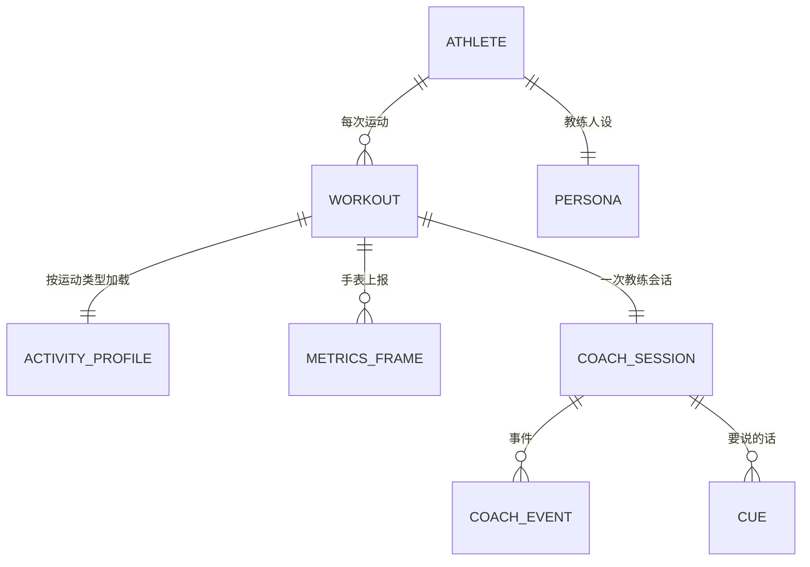

# coach-w 产品设计与技术架构

| | |
|---|---|
| 版本 | v0.1 |
| 日期 | 2026-11-21 |
| 状态 | 草案。M1 待户外真机验收；M2 服务端已部署上云，iOS 已接入 LiveKit（手机端开口对话待实测）；M3 教练大脑代码完成，待真实跑步验收；M4 扩展（散步 / 徒步 / 骑行 / 兜底档案、断网兜底与重连续接、跑后总结与本机记录、手表 GPS）代码完成，待三种运动户外实测（第 13 节）。 |

这是 coach-w 最核心的文档。产品范围、领域模型、架构、技术选型都以本文为准；改动这些内容时先改本文，再改代码。

## 1. coach-w 是什么

**一个一直在你身边的实时语音运动教练。** 手表看着你的身体，耳机里有人陪你说话。

用户戴着 Apple Watch、带着 iPhone、戴着耳机（首先是韶音骨传导）去运动。手表实时采集心率、配速、步频、功率、跑姿等指标，iPhone 把指标和用户的声音一起送到服务端的教练 Agent，教练用实时语音模型（首选 Qwen Realtime）在耳机里说话：给指令、纠正、鼓励，也能随时聊天、随时被打断。

目标体验：**像一个骑着电瓶车的教练一直在你边上**，看着你跑，知道什么时候该说话、什么时候该闭嘴。

### 1.1 三个核心点

1. **实时双工语音。** 不是"生成一句台词再播放"，而是像打电话一样的对话：用户随时插话，教练随时被打断，延迟以秒内为目标。
2. **数据驱动、不靠猜。** 教练说出的每个数字都来自手表数据（工具调用或注入的状态），模型不估计、不编造。
3. **通用内核，运动档案。** 数据通路、语音通路、教练编排与运动类型无关；每种运动的差异只写在运动档案（Activity Profile）里。跑步是主线，骑行、散步随后，其余 Apple 支持的运动由通用兜底档案覆盖。

### 1.2 一等对象是"这次运动"，教练是陪伴者

用户面对的是"今天这次 5 公里"和"我的教练"，不是"一个语音会话"。LiveKit 房间、模型会话、重连都是内部实现。会话断了可以重建，这次运动不能丢：运动数据以手表的 `HKWorkoutSession` 为准，语音中断不影响记录。

### 1.3 与同类项目的区别

| 项目 | 它是什么 | coach-w 的不同 |
|---|---|---|
| [aarc](https://github.com/alphato-o/aarc)（Apache-2.0） | iPhone + Watch 跑步 App，Claude 写台词、ElevenLabs 播放；回话走 Siri 转写 | 学它的编排（Director、优先级队列、过期丢弃、等音乐间隙）和"手表是唯一数据源"；但我们是实时双工语音，教练大脑在服务端，覆盖多种运动 |
| [pace-pilot](https://github.com/fabianferno/pace-pilot)（未声明许可） | iOS → WebRTC → Pipecat → Gemini Live 的跑步教练 | 架构最接近，学它"数据只能通过工具拿"和"运动中只开放少量工具"的思路；**未声明许可，不复制代码** |
| Apple 健身 / Workout App 自带提醒 | 阈值提醒、Pacer | 不能对话，不看趋势，没有人格 |

### 1.4 不做的事

- 自己做 STT → LLM → TTS 的级联作为默认实现。默认是原生 speech-to-speech 实时模型；级联只作为断网兜底或模型不支持时的降级。
- 游泳的实时语音（蓝牙在水下不可用），只做手表震动。
- 在客户端持有模型厂商的 API Key。
- 让模型自己决定什么时候主动说话（见 4.2）。
- 第一版不做账号体系、社交、排行榜、训练计划市场。

## 2. 用户旅程

1. 安装 iPhone App，手表上的 App 随之安装（watchOS App 打包在 iOS App 内）。首次打开授权 HealthKit、麦克风、定位。
2. 在 iPhone 上选运动类型（跑步 / 骑行 / 散步 / 其他）和今天的目标（轻松跑、配速 5'30"、心率不超过 Z3、只是随便走走聊聊）。
3. 点开始：iPhone 拉起手表 App 并开始 workout；同时加入语音房间，教练用一句话打招呼并确认目标。
4. 运动中：教练按阶段和节点陪跑，异常时主动提醒，用户随时说话。关键提醒同时在手表上震动。
5. 用户说"安静一会儿"或按耳机键，教练静音几分钟；紧急情况（心率过高）除外。
6. 结束：手表保存 workout 到 Apple 健康；教练做一句话总结；App 里留下本次的指标曲线和教练说过的话。

## 3. 领域模型



| 对象 | 含义 |
|---|---|
| **Athlete（运动者）** | 用户。年龄、最大心率、心率区间、习惯配速等。第一版存在 iPhone 本地，开始时随会话发给服务端。 |
| **Workout（运动）** | 一次运动，对应手表上的一个 `HKWorkoutSession`。有运动类型、目标、开始/暂停/结束状态。 |
| **Activity Profile（运动档案）** | 一种运动的教练定义：关心的指标和单位、阶段、事件规则、模式（教练 / 陪伴 / 引导）、说话频率、可用工具。见第 5 节。 |
| **Metrics Frame（指标帧）** | 手表每 1–2 秒发出的一帧原始指标。见 6.3。 |
| **Metrics State（指标状态）** | 服务端对指标帧的聚合：最新值、30 秒 / 2 分钟 / 全程窗口、趋势、分段。 |
| **Coach Event（事件）** | 由规则或导演产生的"值得说点什么"的事：心率超区间、整公里、半程、站住不动等。带类型、优先级、负载。 |
| **Cue（提示）** | 准备说出口的一条话：来源事件、优先级、冷却键、过期时间、是否允许打断、是否同时震动。 |
| **Coach Session（教练会话）** | 服务端一次 LiveKit 房间里的 Agent 会话，内部持有实时模型会话。可重建。 |
| **Persona（人设）** | 教练的性格与语气（严厉 / 温和 / 毒舌）、声音、话多话少。 |

### 3.1 用户与扩展

目标是以后像 Keep 一样开放注册，但现在只有维护者和几个朋友用。原则：**留好接缝，不提前建系统。**

**现在（M2 起，邀请制）：**

- 每台 iPhone 首次启动生成一个 `athlete_id`（UUID，存 Keychain）。运动者资料（最大心率、心率区间、习惯配速）存在手机上，开始运动时随会话发给服务端。
- token API 用**邀请码**换 LiveKit token：服务端环境变量里配一组邀请码，每个码对应一个人（名字和每日语音分钟上限）。不建数据库。
- 服务端教练状态只在会话内存里，按 `athlete_id` 区分；日志只记 `athlete_id`，不记名字。
- 每日语音分钟上限从第一天就有：实时语音模型按时长计费，朋友用也要防止意外超支。

**M2 的实现（`server/src/coachw/api/`）：**

- 邀请码在环境变量 `COACHW_INVITES`：逗号分隔的 `code:name:daily_minutes`，码至少 12 个字符。比较用常量时间。名字只给运维看，不进日志、不进 token、不发给 Agent。
- `POST /v1/session`，请求体 `{invite_code, athlete_id}`（`athlete_id` 必须是 UUID）。成功返回 `{server_url, room, token, token_expires_at, max_session_s}`；未知邀请码 401，`athlete_id` 不合法 422，当日分钟不足 429（见下）。
- token：每次新建一个房间 `coach-<随机>`，只能加入这个房间；identity 是 `athlete_id`；有效期 `COACHW_TOKEN_TTL_S`（默认 10 分钟，只管"多久内能加入"）；房间配置里 dispatch 教练 Agent（`coach-w`），最多 2 个参与者。participant metadata 里签入 `{athlete_id, max_session_s}`，客户端改不了。
- 分钟上限按邀请码（即按人）计，"一天"按 `COACHW_QUOTA_TZ`（默认 Asia/Shanghai）。签发 token 时预占本次会话上限 `min(当日剩余, COACHW_SESSION_MAX_MINUTES)`，剩余不足 `COACHW_MIN_SESSION_S`（默认 60 秒）时返回 429。LiveKit webhook（`participant_joined` / `participant_left`，只在本机回环地址可达）把预占结算成实际在房间里的时长；token 过期仍未加入的预占自动释放。并发拿多个 token 也不会超额。同一 `athlete_id` 再次申请（断线重连、加入失败后重试）时，它之前的会话不再按预占计，只计实际在房间里的时长：手机同一时间只有一路语音，LiveKit 还没察觉断线的旧会话不能让重连因"分钟用完"失败（会话上限等于每日分钟时必现）。
- 会话时长上限由 Agent 执行：到 `max_session_s` 时说一句告别，然后删除房间。只有上限被当日剩余分钟压低（小于 `COACHW_SESSION_MAX_MINUTES`）时才说"今天的时长用完了"；单次会话到顶时说"这一次的时长到了，可以重新连接"。
- **计数只在 API 进程内存里，进程重启当日用量清零。** 几个人用时可以接受；开放注册时随账号表一起换成数据库。

**必须守住的接缝：**

- 服务端所有接口和会话都带 `athlete_id`，不出现"只有一个用户"的假设（全局单例状态、写死的个人参数）。
- 运动者资料是会话的输入，不写死在提示词或代码里。
- 邀请码校验集中在 token API 一处，以后整体换成正式登录。

**以后（开放注册时）：**

- 用 Sign in with Apple 换掉邀请码，服务端加账号表（届时再选数据库）。
- 运动历史和教练记忆在用户同意后同步到服务端。
- 按账号做配额和计费。

## 4. 教练如何工作

### 4.1 分层

```text
MetricsFrame ─▶ MetricsState（多窗口趋势）
                    │
       ┌────────────┼──────────────┐
       ▼            ▼              ▼
  Director     EventEngine    Tools（get_metrics / adjust_target …）
 （阶段+节点）  （阈值+趋势）          ▲
       └─────┬──────┘                │
             ▼                       │
   CueQueue（优先级 / 冷却 / 过期 / 闭嘴规则）
             │                       │
             ▼                       │
   Realtime 模型会话 ─────────────────┘
  （把 cue 说自然 + 自由对话）
             │
             └─▶ 关键 cue 同时下发手表震动
```

### 4.2 原则：时机由确定性代码决定，表达交给模型

- **说不说、什么时候说**由 Director、EventEngine、CueQueue 决定，是可测试的普通代码。
- **怎么说**交给实时模型：CueQueue 放行一条 cue 时调用 `generate_reply`，内容里带上事实（"心率 178，已连续 25 秒高于 Z4 上限 172"）和语气要求，模型说成一句自然的话。Qwen 下以**用户角色的文字消息**（`generate_reply(user_input=...)`，以"【教练提示】"开头）传入，而不是 `instructions=`：后者被插件做成会话中途的 system 消息，Qwen 实测基本不理会，回答的是最后一条用户消息（14.1）。系统提示词说明【教练提示】不是用户说的话。
- **常识交给模型，但要在开口那一刻提醒**：不为"骑车被当成跑步"之类的情形写专门规则（覆盖不全）。系统提示词说明教练懂运动常识、数据不合常识时直说并问用户、【教练提示】里的"鼓励"只是默认语气；除安全提醒外，每条【教练提示】还带一句"说之前先用常识想一想，这些数据放在用户正在做的某运动里说不说得通"。2026-11-22 实测（COCH-15，`qwen-audio-3.1-realtime-flash`，纯文本探针）：只写在系统提示词里时，"第 3 公里 4 分 22 秒、心率 127、步频 72"三次都照念或夸；cue 里带上这句后五次中四次指出步频不对并问用户，另一次只播报不夸；正常的 5 分 30 秒公里五次都没有误报。
- **自由对话**是实时模型的正常行为。用户问数据时，模型必须调用工具（`get_metrics` 等），系统提示词里明确禁止估计数字。

#### 4.2.1 写稿模型（开发者选项，测试阶段，COCH-15）

- 手机设置页"开发者选项"里选"教练主动播报怎么写"：实时模型直接说，或先由文本模型写稿（默认 `qwen3.8-flash`，可选 `qwen3.8-max`、`deepseek-v4.1-flash`）。选择随 `POST /v1/session` 的 `cue_writer` 发给 token API，签进 `SessionMeta`；服务端只接受 `COACHW_WRITER_MODELS`（默认上述三个）里的，其余当作不写稿。重新连接教练后生效。
- 写稿时机不变，仍由 CueQueue 决定。放行一条非安全类 cue 时，`agent/cue_writer.py` 把运动类型、最近 8 句对话、状态摘要、cue 事实和语气交给文本模型（`providers/writer.py`，DashScope 兼容接口，关思考，4 秒超时），要求用常识判断数据、只用给出的数字、一两句口语；写好的话以"【教练提示】把下面这句话自然地说给用户听…"交给实时模型说出。写稿失败、超时或写进了事实里没有的阿拉伯数字时，退回原来的 cue。安全提醒不经过写稿。用户的提问仍由实时模型直接回答。
- 2026-11-23 实测（纯文本，COCH-15 的两组数据，各 2–3 次）：`qwen3.8-flash` 约 1 秒、`qwen3.8-max` 约 1.6 秒、`deepseek-v4.1-flash` 约 0.6 秒，都对"4 分 22 秒、步频 72"提出质疑，对正常的 5 分 30 秒没有误报；`qwen-flash` / `qwen-plus` 照样夸，没选；`qwen3.7-plus` 免费额度已用完。
- 每 30–60 秒向会话写入一条**不触发回复**的文本状态摘要，让对话时模型知道运动进行到哪里：阶段、大致用时和距离、目标、是否静音，以及**手表此刻的实时数据**（档案的口语读法，例如"心率 152，配速每公里 5 分 32 秒"；没有实时数据时写明没有）。用户一开口（`user_state` 变为 `speaking`，同一句话的几段 2 秒内只刷新一次）就立即替换成那一刻的摘要，所以用户话说完时模型手里就是当前数据，问心率配速可以直接答，不依赖模型记得调用工具。原先摘要不写心率配速，是怕模型沿用旧数字（14.2）；但真机上模型常常不调工具，结果要么沿用旧值、要么说"看不到 / 懒得查"（COCH-18）。摘要随时替换为最新一条，旧的不留在对话里。分段、目标、总结仍走工具。

### 4.3 Director：一次运动的时间线

- 阶段由运动档案定义，例如跑步：准备 → 热身 → 主训练 → 放松 → 结束。
- 节点：开始、每公里（或每 N 分钟）分段、半程、最后一公里、结束。
- 节点之间的"陪伴"：按档案的间隔主动搭话，例如询问感受、谈话测试（"能说完整句子吗？"）。

### 4.4 EventEngine：看趋势，不看瞬时值

- 输入 MetricsState，输出 CoachEvent。规则写在运动档案里。
- 规则基于窗口而非单点，例如"心率连续 20 秒高于区间上限"、"最近 2 公里每公里掉速超过 10 秒"、"后半程触地时间比前半程增加 8%"。
- 传感器缺失时规则自动失效，不能产生误报（例如没有骑行功率计就没有功率规则）。

### 4.5 CueQueue：闭嘴比说话更难

- **优先级**：紧急（安全类，如心率过高）> 纠正 > 节点播报 > 陪伴闲聊。
- **冷却**：同一冷却键在冷却时间内不重复。
- **过期**：每条 cue 有过期时间，过期直接丢弃，不迟到播报（借鉴 aarc）。
- **不插话**：用户在说话时不放行非紧急 cue；教练正在说话时，只有紧急 cue 可以打断。
- **静音**：用户要求安静时，在静音时长内只放行紧急 cue。
- **密度**：状态平稳时拉长陪伴间隔；档案定义每分钟最多说几次。

### 4.6 三种模式

| 模式 | 适用 | 行为 |
|---|---|---|
| 教练 | 跑步、骑行 | 有目标，主动纠正和鼓励，节点播报完整 |
| 陪伴 | 散步、徒步 | 以自由聊天为主，偶尔报距离和时间，加安全关怀；几乎不纠正 |
| 引导 | 瑜伽、拉伸、冥想（后续） | 慢语速，按节奏带着做 |

### 4.7 工具

运动中只开放少量工具，降低延迟（pace-pilot 的经验）。通用工具：`get_metrics`、`get_progress`、`set_quiet(minutes)`、`end_workout_summary`。档案可增加自己的工具，例如跑步的 `adjust_target_pace`。

Qwen Realtime 的 function calling 经 `livekit-plugins-aliyun` 1.8.10 端到端可用（14.1），但插件有一个缺陷要绕开：Qwen 常在用户这句话的转写到达之前就调用工具，插件在工具返回后同步上下文时，把这条还没有文字的语音消息当成空消息**从服务端会话里删掉**，模型随后回答的是更早的一条文字消息（实测表现为重复开场白或答非所问）。`coachw.providers.qwen` 在同步时保留这类待转写的用户消息，修复后连续 3 轮冒烟全部答对。升级插件时先跑冒烟（7.2），确认问题是否已在上游修复。

工具结果以 JSON 字符串返回（框架会把非字符串结果 `str()` 成 Python 表示）。不可用时的退路仍是"每次 cue 的指令里带上最新指标"。

M3 的工具：

| 工具 | 返回 |
|---|---|
| `get_metrics` | 最新一帧里有的指标、`age_s`、`pace_per_km`（档案按速度读的运动改为 `speed_kmh`）、`spoken`（档案给出的各指标口语读法，如骑行"每小时 25 公里"）；超过 10 秒没有新帧时 `available: false`；不含坐标 |
| `get_progress` | 阶段、用时、距离、最近 5 个分段（用时和分段平均值）、目标与剩余距离、静音剩余时间 |
| `set_quiet(minutes)` | 静音 0–30 分钟（0 取消），期间只放行紧急 cue |
| `end_workout_summary` | 总用时、距离、档案关心的各指标全程平均值及口语读法、能量、全部分段、最快 / 最慢分段、各类提醒次数 |
| `adjust_target_pace(pace_min, pace_sec, goal_km?)`（跑步档案） | 设置或取消目标配速（2'30"–15'00"），可同时设置目标距离（0–100 公里） |

档案工具在收到第一帧、知道运动类型后才注册到会话（`Agent.update_tools`），同时把档案的提示词片段追加到系统提示词（`update_instructions`）。

### 4.8 实现（M3，`server/src/coachw/coach/`）

```text
coach.metrics ─▶ CoachBrain.on_frame ─▶ MetricsState
                                    （按 activity 选档案，换运动类型时重建状态）
CoachLoop（每秒一次）─▶ CoachBrain.tick ─▶ EventEngine + Director ─▶ CueQueue
                     │                                              │ Delivery
                     ├─▶ session.interrupt()（紧急且教练在说话）       │
                     ├─▶ session.generate_reply(user_input=…)  ◀───┘
                     ├─▶ coach.cue（有震动的 cue）
                     └─▶ 每 45 秒 Agent.inject_status（空闲时）
```

- **`MetricsState`**（`metrics_state.py`）：时间轴用手表的 `elapsed_s`，所以手机后台恢复时批量补发的帧也落在正确位置；新鲜度用服务端收帧时间，超过 10 秒判为过期。只有 `state == running` 的帧进入窗口、分段和基线。提供任意长度的滑动窗口（均值 / 最值，至少 3 个样本、覆盖窗口 60% 才算数，例如 10 / 30 / 60 / 120 秒）、"连续满足条件多久"（缺测的样本打断连续）、按档案分段长度切分（跨分段点时线性插值）、基线（档案定义的时间段，跑步为第 5–15 分钟，用来做前后半程对比）、全程均值。只保留最近 5 分钟的样本，坐标不进入任何聚合。
- **`EventEngine`**（`events.py`）：通用规则类型 `Sustained`（连续高于 / 低于阈值多久）、`WindowVsBaseline`（窗口均值相对基线变化）、`WindowVsTarget`（窗口均值偏离目标，可先换算成配速等单位）、`SplitTrend`（连续几个分段单向变化）。阈值可以是常数，也可以是会话目标的名字，**目标或传感器缺失时规则不触发**；数据过期或 workout 暂停时全部规则静默；规则可设起始时间（例如热身期间不提配速）。
- **`Director`**（`director.py`）：阶段按档案定义（按用时或按目标距离比例进入）；节点：开始、阶段切换、每个分段、半程、最后一个分段、完成目标、结束，每个只触发一次；手表数据中断 30 秒提示一次（只看进行中的运动：暂停时手表不发心跳，安静是因为暂停）；没有节点时按档案间隔发陪伴 cue，间隔从上一次 cue 或上一次对话（用户或教练在说话）算起，刚聊完不会马上再找话题，话题只在陪伴 cue 真正发出后才换下一个；档案定义的时长（跑步 5 分钟）内没有纠正或紧急提醒时，间隔乘以档案的"平稳系数"。没有距离分段的档案可设时间节点（每 N 分钟，M4 兜底档案为 10 分钟），会话中途加入时不补报已过去的节点。开始节点的话术由档案的 `start_hint` 给出。结束节点即跑后一句话总结（M4）：用时、距离、档案前两个指标的全程均值（如平均心率、平均配速 / 时速）、能量、最快分段，加档案的 `end_hint`（"用一句话总结并夸奖用户…"），数据与 `end_workout_summary` 同源，不需要模型再调工具。
- **`CueQueue`**（`cue_queue.py`）：4.5 的全部规则。同一冷却键已在队列里时不重复入队，更紧急的替换掉不那么紧急的；不那么紧急的 cue 的冷却挡不住更紧急的（心率"偏高"刚播过，"过高"照样能播），反之更紧急的播过后同键的次级提醒在其冷却期内不再出现。密度：非紧急 cue 每滚动一分钟不超过档案上限，两条之间至少间隔档案的 `min_gap_s`；紧急 cue 不受密度和静音限制。用户说话（`user_state == speaking`）或教练说话 / 思考（`agent_state` 为 `speaking` / `thinking`）时只放行紧急 cue，教练在说话时紧急 cue 先 `interrupt()` 再说。开启静音时清掉队列里的非紧急 cue。
- **`CoachBrain`**（`brain.py`）：一个会话一个，按 `athlete_id` 区分，全部是内存态。语音会话可以跨好几场运动：上一场结束后（或结束帧丢了、运动时间倒退超过 5 秒）来的下一场运动重新载入档案、从零开始教练状态。把 cue 转成给模型的指令（"【教练提示】事实 + 语气要求 + 只用这里的数字"），有震动的紧急 / 纠正 / 节点 cue 同时生成 `coach.cue`（陪伴 cue 不震动）。也负责回答工具。
- **Agent 接入**（`agent/loop.py`、`agent/coach.py`、`agent/worker.py`）：Agent 一进房间就注册数据回调（`AthleteInbox`），在知道运动者身份前先暂存数据包，避免手机在 Agent 加入瞬间发的 `coach.resume` 丢失；开场白最多等 2 秒的 `coach.resume`，收到则改为"语音刚连上、运动没中断（用时、距离）"的一句话，否则是首次问候。开场白先发、`CoachLoop` 后启动：开场白是 `instructions=` 回复，Qwen 只在会话里还没有用户消息时照做，而 cue 是用户消息（14.1）。`CoachLoop` 每秒调用一次 `tick`；状态摘要每 45 秒替换一次（`update_chat_ctx`，删掉上一条再加新的，对话里始终只有一条摘要），定时替换只在双方都没说话时写；用户开口时另外立即替换一次（4.2）入。日志只记 cue 的 id、类型、优先级，不记事实文本（含指标值）。
- 运动者的最大心率还没有从手机传上来（3.1），跑步档案暂时按 190 计算心率上限（90% → 171）和安全上限（97% → 184）；`Athlete.max_hr_bpm` 已留好接缝。

## 5. 运动档案（Activity Profile）

### 5.1 结构

每个档案是一份声明式配置加少量代码，放在 `server/src/coachw/profiles/`：

- `activity_types`：对应的 `HKWorkoutActivityType`（如 `running`）。
- `mode`：教练 / 陪伴 / 引导。
- `metrics`：关心哪些指标、怎么读（跑步说"配速 5 分 30"，骑行说"时速 28"）。
- `phases`、`milestones`：Director 用。
- `rules`：EventEngine 用。
- `cadence`：陪伴间隔、每分钟最多几次。
- `tools`：额外工具。
- `prompt`：档案专属的系统提示片段。

**通用内核里不出现运动类型的分支判断**，差异全部在档案里。

### 5.2 首批档案

| 档案 | 优先级 | 指标 | 说明 |
|---|---|---|---|
| 跑步（室外 / 跑步机） | P0 | 心率、配速、距离、步频、功率、步幅、触地时间、垂直振幅、GPS、海拔 | 维护者的手表是 Apple Watch Series 8（watchOS 26.6.1），支持跑步功率和跑姿指标；实际上报情况待实测（14.2） |
| 散步 / 徒步 | P1 | 心率、配速、距离、步数、海拔 | 陪伴模式，最容易做好 |
| 骑行（室外 / 室内） | P1 | 心率、速度、距离、海拔；踏频和功率需要蓝牙传感器 | 语音要短；路上安全优先 |
| 通用兜底 | P1 | 心率、时长、卡路里 | 覆盖其余所有类型，陪伴模式 |
| 力量 / HIIT | P2 | 心率 | 只能按组间休息和心率引导 |
| 游泳 | 不做语音 | — | 只做手表震动 |

### 5.3 实现（M3）

- 结构是 `profiles/base.py` 的 `ActivityProfile`（冻结的 dataclass）：`activity_types`、`mode`、`metrics`（字段、名称、口语读法）、`phases`、`split_m` 与分段播报文案、`rules`（4.8 的通用规则实例）、`cadence`（陪伴间隔、平稳系数、每分钟上限、最小间隔）、`prompt`、陪伴话题、默认目标、`tools`、基线时间段。
- 注册表 `profiles/registry.py`：按线协议 `activity` 查档案，一个运动类型只能属于一个档案；没有专属档案的运动用兜底档案。
- 兜底档案（`fallback.py`）M3 是最小版本，M4 已补全（见下文 5.4）。
- 测试 `tests/test_profiles.py` 检查 `coach/` 里没有出现运动类型名字。

跑步档案（`running.py`）：

| 项 | 内容 |
|---|---|
| 模式 | 教练 |
| 阶段 | 热身（开始）→ 主训练（10 分钟后）→ 放松（完成目标距离 90%，需设目标）；准备 / 结束由内核给出 |
| 分段 | 每公里，播报用时、平均心率、平均步频 |
| 心率过高（紧急） | 连续 15 秒高于安全上限；冷却 90 秒；震动 `failure` |
| 心率偏高（纠正） | 连续 30 秒高于目标上限；冷却 180 秒；与上一条共用冷却键；震动 `direction_down` |
| 配速偏慢 / 偏快（纠正） | 设了目标配速、热身后，最近 60 秒平均配速偏离目标超过 15 秒/公里；冷却 180 秒；震动 `direction_up` / `direction_down` |
| 持续掉速（纠正） | 连续 2 个公里每公里都比上一公里慢 10 秒以上；每个新分段最多一次 |
| 步频下降（纠正） | 最近 60 秒平均步频比基线（第 5–15 分钟）低 5% 以上；冷却 5 分钟 |
| 触地时间上升（纠正） | 最近 120 秒平均触地时间比基线高 8% 以上（即后半程跑姿走样）；冷却 10 分钟 |
| 密度 | 陪伴每 4 分钟（平稳时 6 分钟），每分钟最多 3 条，两条至少间隔 10 秒 |
| 工具 | `adjust_target_pace` |

阈值是按常识定的初值，要在真实跑步里调（14.2）。

### 5.4 实现（M4）

`ActivityProfile` 新增字段（都有默认值，跑步档案不变）：`start_hint` / `end_hint`（开始节点、结束总结的话术）、`speed_as_pace`（速度读作配速还是时速，决定 `get_metrics` 给 `pace_per_km` 还是 `speed_kmh`）、`time_mark_s` / `time_mark_facts`（没有距离分段时的时间节点）。注册表：`running` → 跑步，`walking` → 散步，`hiking` → 徒步，`cycling` → 骑行，其余（含 iOS 的"其他"）→ 兜底。内核仍不出现运动类型（`tests/test_profiles.py` 检查）。

散步 / 徒步（`walking.py`，两个档案共用一套定义，名称与提示词不同）：

| 项 | 内容 |
|---|---|
| 模式 | 陪伴 |
| 阶段 | 只有"散步中 / 徒步中" |
| 分段 | 每公里，只顺口报用时，不点评快慢 |
| 规则 | 只有心率过高（紧急）：连续 20 秒高于安全上限（最大心率 97%）；冷却 120 秒。没有任何配速、跑姿纠正 |
| 陪伴 | 每 5 分钟（平稳时 7.5 分钟），话题以聊天为主，夹带安全关怀（路况、喝水）；徒步加上坡、下坡、补给 |
| 密度 | 每分钟最多 2 条，两条至少间隔 20 秒 |
| 读法 | 配速"每公里几分几秒"；徒步提海拔 |

骑行（`cycling.py`）：

| 项 | 内容 |
|---|---|
| 模式 | 教练，但每次一句、很短，路况安全优先 |
| 阶段 | 热身 → 主骑行（10 分钟后）→ 放松（完成目标距离 90%） |
| 分段 | 每 5 公里，播报用时和这 5 公里的平均时速 |
| 读法 | 速度读"每小时多少公里"（`speed_as_pace = False`），踏频"每分钟多少转"，功率"多少瓦" |
| 心率过高（紧急）/ 偏高（纠正） | 连续 15 秒高于安全上限 / 连续 45 秒高于目标上限（最大心率 90%），共用冷却键 |
| 踏频下降（纠正） | 热身后，最近 2 分钟平均踏频比基线低 10% 以上；冷却 10 分钟 |
| 功率下降（纠正） | 热身后，最近 3 分钟平均功率比基线低 15% 以上；冷却 15 分钟 |
| 密度 | 陪伴每 7 分钟，每分钟最多 2 条，两条至少间隔 20 秒 |

没有蓝牙踏频 / 功率传感器时这两个字段缺省，窗口和基线都没有数据，规则不触发（有单元测试）。

通用兜底（`fallback.py`）：陪伴模式，只用心率、时长、能量；不分距离段，每 10 分钟一个时间节点（"已经运动 20 分钟，消耗了 150 千卡"）；心率过高（紧急，15 秒）和心率偏高（纠正，60 秒，冷却 10 分钟）；提示词要求不提距离、配速。

单元测试：`tests/test_activities.py`（各档案用合成帧端到端跑 `CoachBrain`：节点、规则、缺传感器不误报、读法、结束总结、坐标不进工具结果）、`tests/test_resume.py`（会话续接，见 7.4）。

## 6. 数据通路

### 6.1 手表：唯一的运动数据源

- watchOS App 运行 `HKWorkoutSession` + `HKLiveWorkoutBuilder`，用 `HKLiveWorkoutDataSource` 按运动类型自动采集。
- workout 结束时由手表保存到 Apple 健康。
- iPhone 不另起一份 workout，不另行计算距离（避免两套数字）。iPhone 单独运动（不戴手表）作为后续选项。

### 6.2 手表 → iPhone

- 首选 **HealthKit 镜像 workout 会话**（iOS 17 / watchOS 10 起）：iPhone 用 `startWatchApp(toHandle:)` 拉起手表 App；手表 `startMirroringToCompanionDevice()`；iPhone 在 `workoutSessionMirroringStartHandler` 里接住会话；双方用 `sendToRemoteWorkoutSession(data:)` 双向传数据。镜像会话也让 iPhone App 在后台保持运行（待实测，14.2）。
- 备选：`WatchConnectivity`。
- 参考：Apple 示例 [Building a multidevice workout app](https://developer.apple.com/documentation/healthkit/building-a-multidevice-workout-app)（WWDC23 10023，MIT 许可）。M1 按它的结构重写，没有逐字复制文件。
- 实现：手表 `apple/Watch/WorkoutController.swift`（主会话、采集、发帧），iPhone `apple/iOS/MirrorReceiver.swift`（接镜像会话、解帧、统计）。读数换算成线协议单位、节流（最多 1 帧/秒，状态变化立即发）、由步数推算步频都在 `CoachKit.FrameBuilder`，命令行可测。运动进行中手表每秒发一帧心跳（没有新读数也发），保证时长持续更新；这样收不到帧就能判断为链路断开，而不是"暂时没有新数据"。首次真机运行时只靠 HealthKit 回调驱动，平均间隔为 1.82 秒，所以加了心跳。
- GPS（M4）：户外运动（跑步、散步、徒步、骑行；"其他"不开）手表用 `CLLocationManager` 定位（`apple/Watch/LocationFeed.swift`，首次使用时请求"使用期间"定位权限，水平精度差于 50 米的点丢弃），定位点写进 `HKLiveWorkoutBuilder.seriesBuilder(for: .workoutRoute())` 返回的 `HKWorkoutRouteBuilder`，随 workout 一起保存到 Apple 健康（不单独调 `finishRoute`）；最新一个点经 `FrameBuilder` 填进指标帧的 `lat` / `lon` / `alt_m`（没有有效垂直精度时不更新海拔）。坐标不打日志。
- 步频：HealthKit 的跑步数据没有直接的步频类型，步行类运动由累计步数在 15 秒窗口内推算；骑行用传感器的 `cyclingCadence`。
- 手机端统计在 `CoachKit.FrameStats`：收到、丢失、乱序帧数，平均间隔，最近一帧的手机与手表时间差（包含时钟偏差）。界面上的"数据流"一节用来回答 14.2 的频率和后台问题。

### 6.3 线协议 v1

指标帧、提示和控制消息都用 JSON，带版本号 `v`。iPhone 收到手表的帧后补上 `phone_ts` 转发给服务端，不改字段含义。

`coach.metrics`（手表 → iPhone → 服务端）：

```json
{
  "v": 1,
  "seq": 128,
  "ts": 1763726400123,
  "activity": "running",
  "state": "running",
  "elapsed_s": 642.5,
  "hr_bpm": 152,
  "distance_m": 2034.1,
  "speed_mps": 3.21,
  "cadence_spm": 172,
  "power_w": 245,
  "stride_m": 1.12,
  "gct_ms": 248,
  "vo_cm": 8.4,
  "energy_kcal": 168.2,
  "lat": 39.9042,
  "lon": 116.4074,
  "alt_m": 45.2
}
```

- 除 `v`、`seq`、`ts`、`activity`、`state`、`elapsed_s` 外都可缺省；缺省表示"这次没有"，不是 0。
- `state`：`running` / `paused` / `ended`（指 workout 状态，与运动类型无关）。
- `ts`：手表的 Unix 毫秒时间。
- 规范样例在 `protocol/fixtures/`，按消息命名（`metrics_frame_*`、`coach_cue_*`），Swift（`CoachKit`）和 Python（`coachw.protocol`）的测试都解析同一份样例。**改协议时三处同一次提交改。**

`coach.cue`（服务端 → iPhone → 手表）：

```json
{
  "v": 1,
  "id": "cue-000017",
  "ts": 1763726460000,
  "expires_at": 1763726475000,
  "priority": "emergency",
  "kind": "hr_emergency",
  "haptic": "failure",
  "text": "心率过高，放慢"
}
```

- 服务端在放行一条带震动的紧急 / 纠正 / 节点 cue 时，经 LiveKit data channel（topic `coach.cue`，可靠传输，只发给房间里的运动者）下发；陪伴 cue 不发。语音照常由模型说。
- 必填：`v`、`id`、`ts`、`expires_at`、`priority`。`ts`、`expires_at` 是服务端的 Unix 毫秒时间。`priority`：`emergency` / `correction` / `milestone` / `companion`。
- 可缺省：`kind`（事件类型，如 `hr_emergency`、`split:3`，只用于日志和展示）、`haptic`（`notification` / `direction_up` / `direction_down` / `success` / `failure` / `retry` / `start` / `stop` / `click`，对应 `WKHapticType`；不认识的值按 `notification` 处理）、`text`（手表上显示的短文案，不含指标值）。
- iPhone 收到后到期的直接丢弃，未到期的经镜像会话 `sendToRemoteWorkoutSession` 原样转给手表；手表再检查一次是否过期，然后震动并在表盘顶部显示文案，最多 4 秒且不超过 `expires_at`。iPhone → 手表这条通道目前只传 cue。
- 手机和手表用自己的系统时间判断过期，依赖三端时钟大致同步（NTP），偏差会直接加减在剩余时间上。

`coach.resume`（iPhone → 服务端，M4）：语音会话（重新）加入一个已经在进行的运动时，手机把它从手表帧里统计的运动摘要发给新会话，让教练接着这次运动继续，而不是从头开始（7.4、8.1）。

```json
{
  "v": 1,
  "ts": 1763727660000,
  "activity": "running",
  "state": "running",
  "elapsed_s": 1260.5,
  "distance_m": 3845.2,
  "energy_kcal": 286.4,
  "km_marks_s": [318.4, 640.1, 965.8],
  "means": { "hr_bpm": 151.3, "speed_mps": 3.08, "cadence_spm": 171.2 },
  "samples": 1180
}
```

- data channel topic `coach.resume`，可靠传输。手机在连上房间时（Agent 已在）和 Agent 加入房间时各发一次，服务端只采纳第一份。
- 必填：`v`、`ts`（手机 Unix 毫秒）、`activity`、`state`、`elapsed_s`。可缺省：`distance_m`、`energy_kcal`、`km_marks_s`（第 i+1 公里完成时的运动用时，单调不减；服务端按档案分段长度取，例如骑行取每第 5 个）、`means`（全程均值，键是指标帧字段名）、`samples`（均值对应的运行帧数）。空列表 / 空对象不上线。
- **不含坐标。** 只有分段时刻和均值，没有任何位置。
- 服务端（`CoachBrain.resume`）：按 `activity` 加载档案，用公里时刻重建已完成分段（分段编号接着来，当前分段从上一个分段点开始计时）、写入全程均值；Director 把开始节点、已完成的分段和时间节点标为已播。已有本会话亲眼看到的分段时不覆盖；分段内均值、跑姿基线、提醒次数和 `adjust_target_pace` 设的目标不恢复。

`coach.control`（双向：开始、暂停、结束、静音）仍然用不到：静音由用户对教练说、模型调用 `set_quiet` 完成；断网兜底在手机本地完成，不需要和服务端交换控制消息。

### 6.4 iPhone → 服务端

指标帧走 LiveKit data channel，topic 即 `coach.metrics`，可靠传输。iPhone 本地按 1 秒节流。

## 7. 语音通路

### 7.1 链路

```text
韶音耳机 ⇄ iPhone（AVAudioSession + LiveKit Swift SDK）
          ⇅ WebRTC（音频轨 + data channel）
LiveKit Server（自部署）
          ⇅
Python Agent Worker（LiveKit Agents）⇄ Qwen Realtime（DashScope WebSocket）
```

- 复用 voicelab 已跑通的链路（维护者本地仓库 `~/voicelab/voice-playground`，未公开）：`livekit-agents` 1.8.10 + `livekit-plugins-aliyun` 1.8.10，模型 `qwen-audio-3.1-realtime-flash`。
- 转向检测默认 `server_vad`。voicelab 实测：`smart_turn` 下打断要约 5 秒才生效，`server_vad` 约 0.5 秒。结束一句话的静音 `silence_duration_ms` 默认 1200 毫秒（`QWEN_VAD_SILENCE_MS`，Qwen 允许 200–6000）：2026-11-22 真实跑步（COCH-15）用 Qwen 默认值时，跑步换气的停顿把一句话切成两三段，教练在第一段后就抢话。待下次户外实测确认 1200 是否合适。
- iOS 不直连 Qwen，不持有模型 Key；token 由服务端签发，限定房间和 Agent。

### 7.2 服务端实现（M2）

- 教练 Agent：`server/src/coachw/agent/`。`worker.py` 是 `AgentServer` 入口（`python -m coachw.agent dev|start`），每个房间一个会话；`coach.py` 是系统提示词和工具；`loop.py` 是 M3 的每秒教练循环（4.8）。指标状态在 `coachw.coach.MetricsState`（M2 的 `metrics.py` 只存最新一帧，M3 并入）。
- Agent 只接受房间里那位运动者（token 的 identity）在 `coach.metrics` 上发的帧，用 `MetricsFrame` 解析；坏帧丢弃并只记错误类型。按 `(ts, seq)` 只保留更新的帧，迟到的帧不覆盖。
- `get_metrics` 返回最新一帧里有的指标、`age_s` 和换算好的 `pace_per_km`；超过 10 秒没有新帧时返回 `available: false`。坐标不给模型。缺省的指标不出现，不报 0。
- 实时模型由 `coachw.providers.get_realtime_model(name)` 创建，`COACHW_PROVIDER` 默认 `qwen`；插件只在 `providers/` 里引用。
- 同一主机预热的空闲进程数 `COACHW_AGENT_IDLE_PROCESSES`（默认 2；LiveKit 生产默认 8，2 核 4G 吃不消）；进程初始化超时放宽到 30 秒（负载高时默认 10 秒不够，实测会导致派单失败）。
- 本机一条命令起全套：`./scripts/dev.sh`（LiveKit 二进制 + token API + Agent，日志在 `logs/`）。`./scripts/dev.sh --lan` 让同一 Wi‑Fi 下的手机连这台 Mac：LiveKit 监听所有网卡并以 en0 地址对外宣告（`--node-ip`），token API 监听 `0.0.0.0`，发给手机的 `server_url` 是 `ws://<局域网IP>:7880`。端到端冒烟：`server/tests/e2e/smoke_voice.py`，用 macOS `say` 提问，用合成指标帧，检查回答里的数字来自工具；`server/tests/e2e/smoke_coach.py`（M3）从运动开始发合成帧，检查开始节点和心率过高时教练主动开口、`coach.cue` 下发、教练说话时紧急 cue 打断、`get_progress` / `set_quiet` 被调用、状态摘要不引起回复。

### 7.2.1 iOS 实现（M2）

- 语音模块 `apple/iOS/Voice/`：`VoiceSession.swift` 是唯一引用 LiveKit Swift SDK（2.19.0，锁定版本）的文件；`TokenClient.swift` 调 `POST /v1/session`。
- 身份与配置 `apple/iOS/Settings/AppSettings.swift`：`athlete_id` 首次启动生成，存钥匙串（锁屏后仍可读，`AfterFirstUnlock`）；邀请码存钥匙串；token API 地址存 UserDefaults，在 App 的"设置"里填。
- 音频会话交给 LiveKit 的自动配置：开麦后是 `.playAndRecord`，选项含 `allowBluetoothHFP` 和 `allowBluetoothA2DP`（SDK 2.19.0 源码 `AudioSessionConfiguration.swift`）。Info.plist 开 `audio` 后台模式、麦克风说明、本地网络说明，ATS 只放开 `NSAllowsLocalNetworking`（开发时连局域网 http/ws）。
- 指标转发：`MirrorReceiver.onFrames` 把镜像收到的每批帧（已带 `phone_ts`）交给 `VoiceSession.send`，以可靠模式发到 data channel 的 `coach.metrics`。按到达顺序串行发送（上一批发完再发下一批），后台恢复时补发的一批帧不会乱序。语音没连上时不发、不缓存：教练只需要最新状态。
- 提示转发（M3）：`VoiceSession` 收 `coach.cue`，解出 `CoachKit.CoachCue`（LiveKit 类型不出语音模块），过期的丢弃，其余交给 `MirrorReceiver.sendToWatch` 经镜像会话转给手表（6.3）。手表 `WorkoutController.present` 震动（`WKInterfaceDevice.play`）并在运动表盘顶部显示文案。
- 连接竞态：`start()` 每次带一个代数，`stop()` 让代数加一；拿 token、连房间、开麦这几步之间发现代数变了就放弃并断开刚连上的房间，所以"连接中"点结束语音后不会再连上开麦。`RoomDelegate` 回调只处理当前房间的事件。
- 设置：邀请码和服务器地址在判断"已配置"、发请求、持久化时都去掉首尾空白和换行，设置页关闭时内存里的值也一并裁剪；服务器地址只接受 `http` / `https`（`CoachKit.ServerAddress`）。"静音"按钮只在已连接时可用。
- 开发构建（DEBUG）可在启动时用环境变量配置：`COACHW_API_BASE_URL`、`COACHW_INVITE_CODE`（写入设置并保存），`COACHW_AUTOCONNECT=1` 启动后自动连接，方便用 `xcrun devicectl device process launch --environment-variables` 免手输测试。正式构建不读这些变量。
- 界面（`apple/Shared/DesignSystem.swift`，维护者 2026-11-23 要求：尽量简洁，参照 Apple Watch「体能训练」和 Apple 原生风格）：纯黑底、系统深色配色、圆体数字，一种强调色（健身圆环绿），每类指标一种颜色（时长黄、心率粉、配速蓝、距离绿）；不用渐变、发光、品牌徽标和自绘卡片，列表和设置用原生 `List` / `Form`。未运动态（`LobbyView`）是原生分组列表：教练状态一行（圆点 + 文字，连接 / 静音 / 断开）、"在手表上开始"的运动列表（点一行直接在手表上开始，该行显示进度）、"上次运动"一行；左上角"记录"、右上角"设置"（未配置时带橙点）。运动中（`WorkoutDashboardView`）按体能训练 App 排版：时长、心率（含区间）、配速 / 时速、距离四行大号数字，下面三列小字只列出本次运动有值的其他指标，一行灰色小字给出数据流统计（6.2），底部"结束""暂停 / 继续"两个圆形按钮（结束要确认）；语音状态在右上角，麦克风按钮轻点静音、长按可断开。记录（`RecordsView`）是原生列表（左滑删除），详情按健身 App 的"体能训练详情"排版：运动详情两列网格、每公里分段、教练对话。设置（`SettingsView`）是原生表单。watchOS（`apple/Watch/ContentView.swift`）：开始页是体能训练 App 式的运动磁贴；运动中左右分页，默认是指标页（时长、心率、配速 / 时速、距离），右滑到控制页（结束、暂停 / 继续），`coach.cue` 在顶部横幅显示。DEBUG 构建支持 `COACHW_UI_PREVIEW` 环境变量在模拟器预览各页面，正式构建不生效。
- 教练说过的话（M4）：livekit-agents 把双方的转写以文字流发到 `lk.transcription`；`VoiceSession` 注册这个 topic，发送者不是自己（用户自己的话以用户身份发出）的整段文字交给 `WorkoutRecorder` 记下。
- LiveKit 的 WebRTC 二进制包约 690 MB，从 GitHub Releases 下载，国内网络下 xcodebuild 自带的下载会超时。可先用 `curl -C -` 断点续传，再按 SwiftPM 的命名放进 `~/Library/Caches/org.swift.swiftpm/artifacts/`（见 `docs/setup.md`）。

### 7.3 音频与耳机

- `AVAudioSession` 用 `playAndRecord` + 允许蓝牙（HFP）以使用耳机麦克风。HFP 下音质降为窄带单声道，对语音足够，音乐会变差。备选：手机麦克风 + A2DP 输出（风噪大）。待户外实测（14.2）。
- 教练说话时压低音乐（`duckOthers`），说完恢复。
- iOS 开启 `audio` 后台模式；锁屏下持续运行依赖后台音频 + 镜像 workout 会话。
- 风噪与喘息可能误触发 VAD。兜底：按键说话（耳机多功能键 `MPRemoteCommandCenter`，或手表按钮）。

### 7.4 断网兜底

- 网络断开时语音会话中断，运动记录不受影响（在手表上）。
- iPhone 本地用 `AVSpeechSynthesizer` 播报紧急类和节点类 cue 的模板文本（由本地规则产生），手表震动照常。
- 网络恢复后自动重连，新会话带上当前状态摘要。

实现（M4）：

- **手机跟踪这次运动**：`CoachKit.WorkoutTracker` 吃手表发来的每一帧（只算 running 帧，时间轴用 `elapsed_s`，不保留坐标），得到公里时刻（跨公里点插值）、全程均值、最高心率、能量。`WorkoutRecorder`（`apple/iOS/Records/`）在镜像会话开始时新建一份，用于续接摘要、本地兜底和运动记录。
- **本地兜底规则**：`CoachKit.LocalCoach`，纯逻辑、命令行可测。只有紧急和节点：心率连续 15 秒高于 184（与服务端默认安全上限一致；缺测打断连续；冷却 90 秒）、每 N 公里（跑步 / 散步 / 徒步 1 公里，骑行 5 公里，与服务端档案的分段一致，表在 `WorkoutActivity.offlineCoach`）、"其他"每 10 分钟、结束。每条带 20 秒过期时间。它在联网时也跑，所以断网那一刻不会补报之前的节点；只有"想要教练但当前没连上"（`VoiceSession.needsLocalFallback`，含重连中）时才由 `LocalSpeaker` 播报并经镜像会话发给手表震动；联网时这些由服务端负责。过期的不播。
- **播报**：`LocalSpeaker` 用 `AVSpeechSynthesizer`（zh-CN）。LiveKit 还占着 `.playAndRecord` 时直接借用；否则临时切到 `.playback` + `voicePrompt` + `duckOthers`，说完交还。紧急提醒打断正在播的本地话。已建立的连接断开时先说一句"网络断了，教练暂时离线…"。
- **自动重连**：`VoiceSession` 把断开分两类（`CoachKit.ReconnectPolicy`）：服务端有意结束（房间被删——会话时长到了、被移出、身份重复）和被拒（邀请码无效、当日分钟用完、其他 4xx）不重连；其余（网络、5xx、LiveKit 自身重连失败、心跳连续不通）按 1、2、5、10、20、30 秒退避重试（之后每 30 秒），每次重新向 token API 申请 token；`NWPathMonitor` 发现网络恢复时立即重试。状态栏显示"网络断开，本机播报中，正在重连…"和自动重连次数。用户点"结束语音"停止一切重试。
- **一次运动一个房间**（COCH-15）：token API 记住每个（邀请码，`athlete_id`）当前的房间，LiveKit 发来 `room_finished` 之前再申请都签同一个房间，所以无论是 LiveKit SDK 自己重连还是应用层重连，手机都回到原来的房间、原来的教练。房间配置和 `livekit.yaml` 把 `departure_timeout` 设为 120 秒（LiveKit 默认 20 秒）：2026-11-22 户外蜂窝网络实测，手机掉线后 30–90 秒才回来，默认值下房间和教练早已关闭。分钟账本按房间计，重进同一房间不另占预留；掉线连接和重进连接在 LiveKit 里短暂并存时只算一次。复用前 token API 经 LiveKit 服务端 API 确认房间里还有教练；教练的会话一结束（用户主动挂断、模型出错），Agent 就退出房间，不留一个不会说话的教练，这样的房间不再复用，下次换新房间、新教练（带对话续接）。
- **心跳**：手机连上后每 5 秒向教练发一次 LiveKit RPC `coach.ping`（教练回 `pong`，常量在 `server/src/coachw/session.py`），4 秒内没回算一次失败，连续 2 次（约 10 秒）就认定链路已死，断开并重进房间，同时本机播报"教练暂时离线"。实测掉线时 LiveKit 自己 30 多秒才察觉（服务端 15:31:10 已判定断开，手机 15:31:44 才进入重连），这段时间用户说话没人听。教练不认识该方法（旧版）时手机关掉心跳。
- **对话续接**：房间关了、只能换新教练时（掉线超过 120 秒、Agent 重启），新教练从对话全文记录里取这名运动者最近 30 分钟、最多 30 句的对话（`transcript.recent_conversation`）放进系统提示词，开场白换成"我回来了，接着刚才的话题"，不重新自我介绍。只在开着对话记录时有效。
- **状态续接**：新会话连上（或 Agent 加入）时发 `coach.resume`（6.3）。服务端接着原来的分段和节点继续，开场白换成"我在线了，继续陪你跑，目前用时…"。本机冒烟见 14.1。
- **断网时说的话**（COCH-15，维护者要求）：链路一断（`onLinkLost`，没静音时），`OfflineVoiceRecorder` 用 `AVAudioRecorder` 把麦克风录到 Application Support/offline-voice/`<时间>.m4a`（16 kHz 单声道 AAC）；重新连上后停止，用 `SFSpeechRecognizer`（zh-CN，设备支持时只在本机识别）转成文字，记进本机对话记录和运动记录（显示为"我"），再以 LiveKit 文本流 `lk.chat`（livekit-agents 的文字输入）发给教练："（刚才断网的时候我说了：…）"，教练接着回应。转写成功后删掉音频，失败的保留。用户主动挂断时只转写、记在本机。待真机验证：LiveKit 断开后 `AVAudioRecorder` 能否在同一音频会话里录到声音，`LocalSpeaker` 播报时会不会一起录进去。
- **运动结束后挂断**：运动结束 5 分钟后，没有新运动开始就自动挂断语音教练（留时间给跑后总结和几句闲聊），避免语音一直连着。

### 7.5 位置与周边（COCH-15）

- 教练工具 `look_around(query)`：用户问"我在哪""附近有什么""哪里有厕所 / 便利店"时调用。Agent 经 LiveKit RPC `coach.places`（请求 `{"query": "厕所"}`，常量在 `server/src/coachw/session.py`）问用户的手机，10 秒超时；结果原样给模型：`{available, here, places: [{name, category, distance_m, direction}], reason}`。
- 手机端 `PlaceFinder`（`apple/iOS/Places/`）用 Apple 地图：位置优先用手表帧里 2 分钟内的 GPS（WGS-84），否则用手机自己的定位（使用期间权限）；`CLGeocoder` 反查所在街道，`MKLocalSearch`（有关键词）或 `MKLocalPointsOfInterestRequest`（没关键词）查 1.5 公里内最近的 5 个地点，给出距离（米）和八方位。坐标不出手机给模型，只给地名、距离、方向；不打日志。
- 选 Apple 地图的理由：Apple 地图在中国大陆用的是高德的数据，不用另外申请地图 Key、不付费，也不用把坐标交给第三家；查询在手机上做。如果实测发现 POI 覆盖不够，再在服务端接高德 Web 服务 API（需要 Key，坐标要从 WGS-84 转 GCJ-02）。
- 待真机验证：锁屏跑步时手机能否完成 Apple 地图查询；国内 POI 的覆盖和准确度。

## 8. 整体架构

```text
┌──── Apple Watch（watchOS App）────┐
│ HKWorkoutSession / LiveBuilder   │
│ 指标帧、震动、抬腕显示              │
└──────────────┬───────────────────┘
               │ 镜像 workout 会话
┌──────────────▼───────────────────┐
│ iPhone（iOS App）                 │
│ 协议转发、音频会话、LiveKit 客户端    │
│ 本地兜底播报、重连续接、运动记录       │
└──────────────┬───────────────────┘
               │ HTTPS（token）/ WebRTC
┌──────────────▼───────────────────┐
│ 服务端（一台云主机，docker compose） │
│ Caddy（TLS）· LiveKit Server        │
│ coachw api（签发 token）            │
│ coachw agent（教练大脑）             │
└──────────────┬───────────────────┘
               │
         DashScope（Qwen Realtime）
```

### 8.1 可靠性

- 运动数据以手表为准，服务端和语音的任何故障都不能丢运动记录。
- 服务端的教练状态是内存态，会话重建时由 iPhone 重新上报当前状态摘要恢复。
- 迟到的 cue 不播（过期丢弃）。

## 9. 技术选型

### 9.1 语言

| 部分 | 选型 | 理由 |
|---|---|---|
| iOS + watchOS | **Swift 6 + SwiftUI** | HealthKit workout、镜像会话、watchOS 只能用原生 |
| 共享 Swift 逻辑 | **SwiftPM 包 `CoachKit`** | 协议模型和纯逻辑，`swift test` 可在命令行测试，不依赖模拟器 |
| Xcode 工程 | **XcodeGen**（`project.yml`） | 工程文件可读、可 diff，coding agent 能改；`.xcodeproj` 不入库 |
| 服务端 | **Python 3.12 + uv** | LiveKit Agents 的 Python SDK 最成熟；直接复用 voicelab |
| token API | Python（与 agent 同一个包，FastAPI，M2 引入） | 服务端只有一种语言 |
| 部署 | docker compose + Caddy | 单机足够 |

### 9.2 工具链

- Swift：`swift test`（CoachKit）、`xcodebuild`（App，M1 起）；格式用 Xcode 自带的 `swift format`（M1 时确认版本后启用）。
- Python：`uv`、`ruff`（lint + format）、`pytest`。
- CI：GitHub Actions，`server` 在 Ubuntu 上跑，`CoachKit` 在 macOS 上跑。

### 9.3 代码结构

```text
apple/
  CoachKit/          SwiftPM 包：线协议（MetricsFrame、CoachCue、CoachResume）、FrameBuilder、FrameStats、ServerAddress、WorkoutTracker、LocalCoach、ReconnectPolicy、WorkoutRecord，iOS 和 watchOS 共用
  project.yml        XcodeGen 工程定义（Bundle ID com.earayu.coachw，手表 .watchkitapp）
  Shared/            两个 App 共用、依赖 HealthKit 的小文件（运动类型表、显示格式）
  iOS/               iPhone App
  Watch/             watchOS App
server/
  src/coachw/
    protocol.py      线协议 v1
    session.py       token API 与 Agent 之间的约定：Agent 名、SessionMeta、athlete_id 校验
    agent/           LiveKit Agent：worker（入口、会话上限）、coach（提示词、工具）、loop（每秒教练循环）
    api/             token API：app（FastAPI）、invites、quota（分钟账本）、tokens、config
    coach/           MetricsState、Director、EventEngine、CueQueue、CoachBrain（M3，4.8）
    profiles/        运动档案：base（结构）、registry、running、walking、cycling、fallback（5.3、5.4）
    providers/       实时模型注册表；qwen.py（从 voicelab 迁移，含插件缺陷绕行，4.7）
  tests/             单元测试；tests/e2e/smoke_voice.py 是需要真 Key 的端到端冒烟，不被 pytest 收集
  Dockerfile         api 和 agent 共用的镜像
protocol/fixtures/   线协议规范样例，两端测试共用
deploy/              docker compose、Caddyfile、LiveKit 配置（生产 / 本机）、.env.example
spikes/              技术验证脚本，不属于产品代码
docs/                文档
```

### 9.4 AirBuild 等 AI App 构建平台

不用于开发。[AirBuild](https://air.build/) 是"AI 团队生成原生 iOS App + 自动处理 App Review"的平台（候补名单制）。我们的难点在 watchOS 镜像会话、实时语音和 Python 服务端，它不覆盖；开发流程已用 Multica + coding agent。上架 App Store 时可以再评估它的 App Review / TestFlight / ASO 自动化。

## 10. 部署

- 一台 Linux 云主机（2 核 4G 起），公网 IPv4，一个域名。
- 地域：中国内地服务器用域名对外提供 80/443 服务需 ICP 备案；未备案时选香港。DashScope 走北京节点。
- 形态：`deploy/docker-compose.yml`，四个服务 Caddy、LiveKit Server（v1.13.11，与本机验证用的二进制同版本）、api、agent，全部 host 网络（与 LiveKit 官方 VM 方案一致：WebRTC 要直接用主机的 UDP 端口）。api 和 agent 共用 `server/Dockerfile` 构建的镜像。操作步骤见 `deploy/README.md`。
- Caddy 给一个域名签 TLS：`/v1/*` 转 token API，其余转 LiveKit 信令（WebSocket）。webhook 路径不对外。
- 端口，按 LiveKit 官方文档（[Ports and firewall](https://docs.livekit.io/transport/self-hosting/ports-firewall/)、[Virtual machines](https://docs.livekit.io/transport/self-hosting/vm/)，2026-11-21 核对）：

| 端口 | 用途 | 对外 |
|---|---|---|
| 80/TCP | Let's Encrypt 签发、跳转 HTTPS | 是 |
| 443/TCP | Caddy：token API + LiveKit 信令 | 是 |
| 7881/TCP | WebRTC over TCP（UDP 不通时） | 是 |
| 50000–60000/UDP | WebRTC 媒体（每个参与者用两个端口） | 是 |
| 7880/TCP | LiveKit API / 信令，只绑 127.0.0.1，经 Caddy 访问 | 否 |
| 8000/TCP | token API，只绑 127.0.0.1 | 否 |
| 8081/TCP | Agent 健康检查，只绑 127.0.0.1 | 否 |
| 3478/UDP、5349/TCP | 内置 TURN（UDP / TLS） | 暂不启用 |

- TURN 暂不启用：服务器有公网 IP，UDP 不通时还有 7881/TCP。官方方案里 TURN/TLS 要占 443，需要第二个域名和 Caddy 的 layer4 模块；移动网络实测（14.2）有需要再加。
- 对外通告的 IP 用 `NODE_IP` 显式配置，不用 `rtc.use_external_ip`：后者靠 Google STUN 发现公网 IP，本机（中国内地网络）实测超时，LiveKit 直接启动失败。
- 本机开发不需要 Docker：`./scripts/dev.sh` 用 LiveKit 二进制（`scripts/install-livekit.sh` 从源码编译到 `.tools/`，或已在 PATH 上的 `livekit-server`）和 `deploy/livekit.dev.yaml`。
- 密钥（LiveKit API secret、DashScope key）和邀请码只放服务器的 `deploy/.env`，不入库。
- 容器日志用 json-file 并限制为每个容器 5 × 10 MB（Docker 默认不轮转）。
- 当前生产：阿里云香港 2 核 4G（Ubuntu 24.04），2026-11-22 部署，实测见 14.1。

## 11. 隐私与密钥

- 心率、位置是健康和隐私数据。服务端只在会话内存里使用，第一版不持久化；日志里不打指标原值和坐标。
- 指标会随工具结果发给模型厂商（DashScope），这是实时教练的前提。坐标不发：`get_metrics` 不返回 `lat` / `lon`，服务端的窗口、分段、摘要、cue 都不含坐标（有单元测试），`coach.resume` 也不带坐标。
- GPS（M4）：手表把轨迹存进 Apple 健康（随 workout），最新坐标随指标帧经 iPhone 转给服务端，只在会话内存里；手表、iPhone、服务端都不打印坐标。
- 本机运动记录（M4）：iPhone 在 Application Support 下每次运动存一个 JSON（指标摘要、每公里用时、教练说过的话和用户说过的话（服务端转写的最终句，2026-11-22 COCH-13 起），不含坐标），文件保护级别 `completeUntilFirstUserAuthentication`，只在本机，可在记录列表里左滑删除。运动中每分钟存一次进度（同一个文件覆盖），镜像会话断开 2 分钟内手表没有重新镜像就在手机上结束并保存：结束信号没传到手机时记录也不丢（2026-11-22 COCH-15，一小时跑步结束时镜像断开、记录全丢）。
- 日志只记 `athlete_id` 和房间名，不记名字、邀请码、指标值；坏帧只记错误类型。iPhone 和手表各自在 Application Support/diagnostics 下留一份诊断日志（`apple/Shared/Diagnostics.swift`，每份不超过 512 KB，保留一份旧的）：按钮点击、workout / 镜像 / 语音状态变化和耗时，不含指标值、坐标和对话文本；iPhone 可在设置里分享，也可用 `xcrun devicectl device copy from` 拉取。LiveKit Agents 在 DEBUG 级别会打印对话文本（可能含说出口的心率），所以 Agent 在本机和生产都用 INFO 级别。
- 对话全文记录（2026-11-22，维护者要求，COCH-13）：服务端 Agent 把每个会话的完整对话按 JSON Lines 写到 `COACHW_TRANSCRIPT_DIR`（生产为 docker 卷 `transcripts`，`<日期>/<房间>.jsonl`，类型 `user` 用户说的话 / `coach` 教练说的话 / `cue` 教练系统的主动提示），不设该变量则不记。iPhone 也把每句对话（不论有没有在运动）按天追加到本机 Application Support/conversations/`<日期>.jsonl`。对话文本可能含说出口的心率等数字，所以只留在主机和手机本地，不入库、不进日志；指标流本身仍不落盘。记录开启时系统提示词告诉教练对话会保存给开发团队看，用户口述产品意见时教练回答"记下了"并复述要点；关闭时教练如实说记不下来（COCH-15）。
- 客户端不持有模型 Key。LiveKit token 短期有效、限定房间。
- 仓库公开：不提交任何凭据、`.env`、个人数据、真实运动记录。测试样例使用合成数据。

## 12. 参考项目与许可

| 项目 | 许可 | 用法 |
|---|---|---|
| Apple 示例 multidevice workout | MIT（示例包内 LICENSE.txt，Copyright 2025 Apple Inc.） | 学结构，M1 自己重写；以后逐字复制时把版权声明写进 `NOTICE` |
| voicelab | 本人代码 | 迁移 Qwen 适配与 Agent 骨架 |
| aarc | Apache-2.0 | 学设计；逐字移植文件时保留版权头并写入 `NOTICE` |
| pace-pilot | 未声明 | 只学思路，不复制代码 |

本仓库许可：Apache-2.0。

## 13. 里程碑

| 阶段 | 内容 | 完成标志 |
|---|---|---|
| **M0 准备** | 仓库、文档、协议 v1、CI；开发账号、服务器、域名、Key（见 `docs/setup.md`） | `docs/setup.md` 清单全部打勾 |
| **M1 数据通路** | 基于 Apple 示例的 iOS + watchOS App，镜像会话，iPhone 实时显示指标帧 | 真机跑一次 1 公里：iPhone 锁屏也持续收到 ≥1 Hz 心率和配速 |
| **M2 语音通路** | 服务端部署（LiveKit + agent + token API），iOS 接入 LiveKit，耳机对话 | 户外戴韶音边走边和教练聊天，可打断 |
| **M3 教练大脑** | MetricsState、Director、EventEngine、CueQueue、跑步档案、工具、手表震动 | 真实 5 公里：分段播报、超心率提醒、问配速答得对 |
| **M4 扩展** | 散步、骑行、通用兜底档案；断网兜底；跑后总结；手表 GPS | 三种运动各实测一次 |

### 13.1 M0 进度

| 项 | 状态 |
|---|---|
| 仓库、许可、AGENTS.md、spec | 完成 |
| 线协议 v1 + 两端解析测试 | 完成 |
| CI | 完成 |
| 准备清单（`docs/setup.md`） | 进行中：开发者账号、Bundle ID、iPhone 和手表的开发者模式、服务器、域名、安全组、部署用 SSH 已完成；韶音耳机配对未完成 |

### 13.2 M1 进度

| 项 | 状态 |
|---|---|
| XcodeGen 工程：iOS App 内嵌 watchOS App，HealthKit 能力 | 完成。模拟器构建通过；真机签名构建通过（2026-11-21，自动签名生成了两个 App 的开发描述文件，签名后的权限包含 HealthKit） |
| 手表：主 workout 会话、镜像、采集、发帧，暂停/继续/结束，可在手表或 iPhone 上开始 | 代码完成，未上真机 |
| iPhone：接镜像会话、实时指标、数据流统计、暂停/继续/结束 | 代码完成，未上真机 |
| GPS 坐标（`lat`/`lon`/`alt_m`） | M4 代码完成（6.2），真机待测 |
| 真机安装 | 完成（2026-11-21）：iPhone 16 Pro（iOS 27.2.1）和 Apple Watch Series 8（watchOS 26.6.1）都已装上，手表 App 能启动 |
| 真机验收：1 公里，iPhone 锁屏也持续收到 ≥1 Hz 心率和配速 | 待维护者实测 |

### 13.3 M2 进度

| 项 | 状态 |
|---|---|
| 教练 Agent：Qwen 适配和 provider 注册表（从 voicelab 迁移）、AgentServer / AgentSession、订阅 `coach.metrics`、每会话最新帧、`get_metrics`、禁止估计数字的提示词、会话时长上限 | 完成。本机端到端冒烟通过（14.1） |
| Qwen 插件工具调用缺陷的绕行（4.7） | 完成，有单元测试 |
| token API：邀请码、短期 token（限定房间、dispatch Agent）、每日分钟上限（内存、预占 + webhook 结算）、日志只记 `athlete_id` | 完成。本机实测：合法码 200、非法码 401、超额 429、webhook 结算、到上限被踢出 |
| 本地一条命令起全套：`./scripts/dev.sh` | 完成 |
| 部署：docker compose（Caddy、LiveKit、api、agent）、`.env.example`、`deploy/README.md`、端口核对 | 完成。已部署到阿里云香港 2 核 4G（2026-11-22）：证书、token API、webhook 不对外、公网端到端语音冒烟（UDP 与 7881/TCP 回退）通过（14.1）；镜像构建和 compose 校验也在 CI |
| 单元测试：协议解析、邀请码、分钟账本、token 内容、API、Agent 指标与工具、provider | 完成（67 个） |
| iOS 接入 LiveKit（语音模块、发 `coach.metrics`、拿 token，见 7.2.1） | 代码完成；真机签名构建、安装到 iPhone 和手表通过（2026-11-22）。手机连本机服务、开口对话尚未实测。QA 提出的输入裁剪、连接竞态、帧顺序、静音按钮问题已在 M3 修复（7.2.1） |
| 局域网开发模式 `./scripts/dev.sh --lan` | 完成：手机经局域网拿到 token（`server_url` 为 `ws://<局域网IP>:7880`） |
| 户外耳机对话（M2 完成标志） | 待维护者户外实测（iOS 已接入） |

### 13.4 M3 进度

| 项 | 状态 |
|---|---|
| `MetricsState`：多窗口、连续时长、分段（插值）、基线、过期检测（4.8） | 完成，有单元测试 |
| `EventEngine` 与通用规则（`Sustained`、`WindowVsBaseline`、`WindowVsTarget`、`SplitTrend`），传感器 / 目标缺失不触发 | 完成，有单元测试 |
| `Director`：阶段、每公里、半程、最后一公里、完成目标、结束、数据中断、陪伴间隔 | 完成，有单元测试 |
| `CueQueue`：优先级、冷却、过期、不插话、静音、密度 | 完成，有单元测试 |
| 运动档案框架、注册表、跑步档案 P0、最小兜底档案（5.3） | 完成，有单元测试；内核无运动类型分支由测试检查 |
| 工具：`get_metrics`、`get_progress`、`set_quiet`、`end_workout_summary`、`adjust_target_pace`（4.7） | 完成，有单元测试 |
| Agent 接入：每会话 `CoachBrain`、每秒 `CoachLoop`、`generate_reply` 表达 cue、紧急 cue 打断、45 秒状态摘要、档案提示词与工具按运动类型加载 | 完成，有单元测试（假会话）。真实模型下的表现见 14.1 / 14.2 |
| 线协议 `coach.cue` v1：spec、fixtures、`coachw.protocol`、`CoachKit` 及双端测试（6.3） | 完成 |
| `coach.cue` 闭环：服务端下发 → iPhone 收 → 镜像会话转手表 → 震动 + 表盘提示 | 代码完成；模拟器构建通过；真机震动待实测 |
| M2 iOS QA 修复（输入裁剪与 scheme 校验、连接竞态、帧串行发送、静音按钮） | 完成；`ServerAddress` 有单元测试，其余为模拟器构建通过 |
| 真实 5 公里（M3 完成标志：分段播报、超心率提醒、问配速答得对） | 待维护者实测 |

### 13.5 M4 进度

| 项 | 状态 |
|---|---|
| 散步 / 徒步档案（陪伴模式、每公里只报用时、仅心率安全规则、安全关怀话题，5.4） | 完成，有单元测试 |
| 骑行档案（教练模式、短句、时速读法、每 5 公里、踏频 / 功率规则缺传感器自动失效，5.4） | 完成，有单元测试；本机冒烟问速度答"每小时 25 公里"（14.1） |
| 通用兜底档案（心率 / 时长 / 能量、每 10 分钟时间节点，5.4） | 完成，有单元测试 |
| 内核无运动类型分支 | 测试检查通过 |
| 跑后一句话总结（结束节点带全程数据，4.8） | 完成，有单元测试 |
| 线协议 `coach.resume` v1：spec、fixtures、`coachw.protocol`、`CoachKit` 及双端测试（6.3） | 完成 |
| 服务端续接：`CoachBrain.resume`、`AthleteInbox` 暂存、续接开场白、开场白先于 cue | 完成，有单元测试；本机冒烟通过（14.1） |
| 手机端跟踪 / 本地兜底规则 / 重连策略（`WorkoutTracker`、`LocalCoach`、`ReconnectPolicy`） | 完成，`swift test` 覆盖 |
| iOS 断网播报（`LocalSpeaker`）、自动重连（退避 + 网络恢复立即重试）、发 `coach.resume`（7.4） | 代码完成，模拟器构建通过；真机断网待测 |
| iOS 本机运动记录（保存、列表、详情：指标、每公里、教练说过的话），首页"刚刚完成" | 代码完成，模拟器构建通过；真机待测 |
| 手表 GPS：定位权限、`HKWorkoutRouteBuilder`、帧里的 `lat` / `lon` / `alt_m`（6.2） | 代码完成，模拟器构建通过；真机待测 |
| 三种运动各户外实测一次（M4 完成标志） | 待维护者实测，见下 |

需要维护者真机户外实测的验收项（iPhone + Apple Watch + 韶音耳机，手机连生产服务）：

1. **散步 / 徒步（20 分钟以上）**：教练以聊天为主、不纠正配速；每公里顺口报一次用时；问"走了多远"答对；徒步时问海拔答得出来；结束时一句话总结。顺带看锁屏下是否一直有声音。
2. **骑行（30 分钟以上，有条件时带踏频 / 功率传感器各骑一次）**：每句话都很短；问速度读"每小时多少公里"；每 5 公里播报一次；没有传感器时从不提踏频、功率；有传感器时数值读法正确；路上不干扰安全。
3. **跑步 + 断网（5 公里，中途开飞行模式 1–2 分钟再关）**：断网后耳机里听到"网络断了…"，之后整公里由手机本地播报、手表照常震动、心率过高（可用高强度冲刺触发）本地播报；关飞行模式后几秒内自动重连，教练说"我在线了…"并带上用时和距离，分段编号接着原来的继续，不重报开始和已过的公里；结束后 App"运动记录"里有这次的指标、每公里用时和教练 / 本机说过的话；Apple 健康里这次 workout 有路线地图。

## 14. 验证记录

### 14.1 已实测

| 项 | 结论 |
|---|---|
| 镜像数据通路首次真机运行（iPhone 16 Pro iOS 27.2.1 + Watch Series 8 watchOS 26.6.1） | 通过，样本很短（2026-11-21，室内静止，未锁屏）。iPhone 收到 5 帧，丢失 0、乱序 0，平均间隔 1.82 秒，手机与手表时间差 74 ms。静止状态下配速、步频、功率、跑姿都是空值，能量为 0。锁屏和户外 1 公里尚未测试 |
| 手表配对开发（watchOS 26.6.1 + iOS 27.2.1 + Xcode 27.2） | 通过（2026-11-21）。watchOS 26 不走 Device Hub 的 "Pair Nearby Device"（那是 watchOS 27 的流程），而是经由数据线连着的 iPhone 被 Mac 发现，需要在手表上点"信任"。信任后设置里仍没有开发者模式开关，直到 Mac 向手表安装一次开发签名 App（因开发者模式未开启而失败）后开关才出现。开启后首次安装报描述文件不含该设备，需用 `-allowProvisioningDeviceRegistration` 以手表为目标构建一次，注册手表 UDID |
| LiveKit + Qwen Realtime（voicelab，浏览器端） | 通过（2026-11-09）。`server_vad` 打断约 0.5 秒；`smart_turn` 约 5 秒 |
| M2 服务端本机端到端冒烟（`server/tests/e2e/smoke_voice.py`） | 通过（2026-11-21，macOS / Darwin 25.6，LiveKit 1.13.11 二进制，`livekit-agents` / `livekit-plugins-aliyun` 1.8.10，`qwen-audio-3.1-realtime-flash`，`server_vad`）。Python 客户端经 token API 拿 token 进房间，每秒发一帧合成指标（心率 137、配速 5'32"，无功率），用 macOS `say` 提问。连续 3 轮全部通过：问心率答"一百三十七"，问配速答"每公里五分三十二秒"，每次都先调用了 `get_metrics`；问功率答"现在拿不到功率数据" |
| Qwen function calling 经 `livekit-plugins-aliyun` 1.8.10 | 可用，但需绕开插件缺陷（4.7）。修复前跑了 5 轮，心率和配速共 10 次提问只答对 2 次：工具都调用了，回答多数是重复开场白或上一句话；抓 Qwen 事件确认插件在工具返回后删掉了刚说完、尚未转写的用户语音消息 |
| `generate_reply(instructions=...)` 在 Qwen 插件下的语义（读源码 + 事件日志） | 会话里还没有用户消息时，指令作为一条合成的**用户**文字消息插入（Qwen 要求先有用户消息才能 `response.create`）；之后作为 system 消息插入。它们只在插件的上下文里，Agent 下一次 `update_chat_ctx` 时会被当作多余项从服务端删除 |
| `generate_reply` 的排队与打断（`livekit-agents` / `livekit-plugins-aliyun` 1.8.10，读源码 + 本机实测 2026-11-22） | 排队：`generate_reply` 生成一个普通优先级的 `SpeechHandle` 进入 `AgentActivity` 的语音队列，不打断正在播的话；插件再把 `response.create` 挡到 Qwen 空闲（用户没在说话、没有进行中的轮次和回复）才发出。实测开场白还在播时放行的"开始"cue 排在开场白之后播出。打断：要先 `session.interrupt()`；`allow_interruptions=False` 在服务端 VAD 下会被忽略（框架告警）。实测教练讲故事时心率过高，cue 带 `interrupt=True` 放行，故事在句中被截断，约 1 秒后开始播报心率提醒 |
| 会话中途的 system 消息对 Qwen 的效果（本机实测 2026-11-22，`qwen-audio-3.1-realtime-flash`） | 基本无效。用 `generate_reply(instructions=...)` 放行 cue 的 2 次运行里：一次"开始"cue 说对了、紧急 cue 却重复了上一条；另一次"开始"和紧急 cue 都重复了开场白（Qwen 事件日志确认 system 消息已建在会话末尾）。改为 `generate_reply(user_input=...)` 后连续 4 次运行，4 次开始节点和 6 次心率过高提醒全部说对，说出的数字只来自 cue |
| M3 端到端冒烟（`server/tests/e2e/smoke_coach.py`，本机 `dev.sh`，LiveKit 1.13.11 二进制，2026-11-22） | 通过（最后两轮全部检查通过）。合成跑步帧从 0 秒开始：开场白后约 7 秒主动播报开始节点（"加油！今天心率别超过171，先慢慢热身"），收到 `coach.cue`（`start`）；心率升到 193 后约 16 秒放行紧急 cue，收到 `coach.cue`（`hr_emergency`、`failure`、有效期 15 秒），教练说"心率193，太高了！立刻放慢，必要时停下来走一走"；空闲 50 秒期间写入状态摘要，教练没有回复；问"跑了多长时间"调用 `get_progress` 并答对约 1 分 36 秒；"安静五分钟"调用 `set_quiet`；"可以说话了，讲个马拉松故事"时再次心率过高，cue 以 `interrupt=True` 放行，故事被截断，约 1 秒后播报心率提醒。日志无循环错误 |
| M2 冒烟在 M3 代码下复跑（`smoke_voice.py`，本机，2026-11-22） | 心率答 137、配速答每公里 5 分 32 秒、功率答没有数据，数字都对；但问配速那一轮没有重新调用 `get_metrics`（沿用上一轮工具结果，见 14.2），检查项 `pace_tool_called` 未过。会话中途加入（帧的 `elapsed_s` 从 600 开始）时没有播"开始"、也没有把加入前的分段当成本次分段 |
| token API 与分钟上限（本机，经 `dev.sh`） | 通过（2026-11-21）。合法码 200、非法码 401、预占用完 429；加入 10 秒后离开，webhook 把预占结算为约 11 秒，下一次签发的上限据此计算；会话上限 60 秒时 Agent 在 60 秒说告别并删房间，客户端 67 秒被断开 |
| Caddyfile 路由（本机 Caddy 2.11.9，域名 localhost） | 通过（2026-11-21）。`/v1/session` 到 API（200 / 401），其余到 LiveKit（`/` 返回 OK，`/rtc` 无效 token 返回 401），`/livekit/webhook` 不对外（404） |
| 服务端上云部署（阿里云香港 `ecs.e-c1m2.large` 2 核 4G，Ubuntu 24.04.5，内核 6.8，Docker 29.10.0，Compose v5.8.0） | 通过（2026-11-22）。`docker compose up -d --build` 一次起来四个容器；Caddy 启动后约 8 秒拿到 Let's Encrypt 证书（颁发者 YE2，90 天）。LiveKit 以 `NODE_IP` 对外宣告，Agent 注册为 `coach-w` 并预热 2 个进程。从本机 Mac 经公网：`/` 返回 OK；`POST /v1/session` 合法码 200，`server_url` 为 `wss://<域名>`，非法码 401；`/livekit/webhook` 和 `/healthz` 返回 404；`:8081` 公网不可达。发现 Agent 健康检查默认监听所有网卡（安全组没放通，但仍改为只绑 127.0.0.1），Docker 日志默认不轮转（已加上限） |
| 公网端到端语音冒烟（`smoke_voice.py --api https://<域名> --agent-log-cmd "ssh ... docker compose logs agent"`，客户端为本机 Mac，中国内地家庭宽带） | UDP 通过，TCP 回退链路通过但一项检查未过（2026-11-22）。UDP：连续 3 轮全部通过，ICE 选中 `udp` 到服务器 50000–60000 端口；每轮心率答 137、配速答每公里 5 分 32 秒、功率答没有数据，都先调用了 `get_metrics`。7881/TCP 回退（在服务器上用 iptables 临时丢弃本机来的 UDP）：ICE 选中 `tcp` 到 7881，开场白、心率、配速、功率回答都正确，但问配速那一轮模型没有再调用 `get_metrics`，直接复用了上一轮工具结果里的数字（`pace_tool_called` 未过；看起来与传输方式无关，见 14.2） |
| M4 端到端冒烟（`server/tests/e2e/smoke_m4.py`，本机 `dev.sh`，LiveKit 1.13.11 二进制，`qwen-audio-3.1-realtime-flash`，2026-11-22） | 通过（修复下述问题后连续两轮全部检查通过；M3 的 `smoke_coach.py` 在 M4 代码下复跑也全部通过，开场白在"开始"cue 之前）。续接：Agent 加入时发 `coach.resume`（21 分钟、3.88 公里、3 个公里时刻），Agent 日志"workout resumed with 3 splits"，开场白"我在线了，继续陪你跑。目前用时 21 分，跑了 3.88 公里"，没有"开始"cue，约 40 秒后越过 4 公里收到 `coach.cue`（`split:4`），教练说"第 4 公里用时 5 分 34 秒…"，没有重报第 1–3 公里。骑行：首次开场白在先（"嘿，我是你的教练。路上骑车安全第一…"），随后"出发啦，先轻松骑，注意路况"；问"我现在骑得有多快"调用 `get_metrics`，答"现在每小时 25 公里"，没有说配速。第一轮发现开场白等 `coach.resume` 的 2 秒里"开始"cue 先放行，开场白的 `instructions=` 被 Qwen 忽略、重复了 cue；改为开场白先发、`CoachLoop` 后启动后修复 |
| COCH-14 修复后复跑冒烟（公网 `coach.apemind.ai`，`smoke_coach.py` / `smoke_m4.py` 加 `--agent-log-cmd` 经 SSH 读 Agent 日志，2026-11-22） | 各 12 项通过 11 项，未通过的两项都由测试机造成，不是代码问题：跑冒烟的 Mac 负载极高（load average 约 300），测试客户端发帧远低于每秒一帧，例如骑行会话 75 秒以上只收到 28 帧，服务端因此正确判定"手表数据中断"并提示。受影响的是 `progress_tool_called`（模型直接回答数据中断，没有调 `get_progress`）和 `answer_in_km_per_hour`（已调 `get_metrics`，但回答被数据中断提示占了）。其余项都通过：开始 / 紧急 cue 与过期时间、`set_quiet`、紧急提醒打断讲故事、不回复状态摘要、`coach.resume` 续接（"我在线啦…21分钟，3.88公里"）、第 4 公里播报且不重报、骑行档案载入、不读配速。同机先用本机 `dev.sh` 跑，客户端连本机 LiveKit 也反复 ping 超时，结论相同。负载正常时应复跑一遍 |
| 2 核 4G 下的资源占用（`docker stats --no-stream`，`COACHW_AGENT_IDLE_PROCESSES=2`） | 通过（2026-11-22）。空闲时 agent 约 490 MB、api 约 50 MB、caddy 约 35 MB、livekit 约 40 MB；一路会话进行中 agent 约 490–510 MB、CPU 10–35%，整机已用约 1.2–1.4 GB / 3.6 GB，可用约 2.2 GB。日志里没有指标值、邀请码，也没有 DEBUG 行 |
| 真机首次完整联调（iPhone 16 Pro iOS 27.2.1 + Watch Series 8，线上服务，2026-11-22，COCH-12，经 Pinky 操作手机） | 部分通过。**镜像会断开再自动接回**：在手表上开跑后 iPhone 收到 `didDisconnectFromRemoteDevice`（无错误），约 14 秒后 HealthKit 交来同一场运动的新镜像会话，帧恢复；旧版把新会话当新运动、把旧会话当活着，表现为时长卡住、暂停 / 结束没反应。**镜像会话的状态回调不可靠**：手机点暂停后手表已暂停（帧里 `state=paused`），手机却没收到 `didChangeTo`，按钮仍显示"暂停运动"。现在手机按手表帧里的 `state` 跟随，结束 5 秒无响应时在手机上收尾。**从手机启动手表**：`startWatchApp(toHandle:)` 两次报 "Unable to open URLs while locked or passcode compliance is pending"（用户称手表已解锁，原因待查）；在手表上直接开跑正常。**手机麦克风全是数字静音**：Pinky 连着手机时，LiveKit 采到的样本峰值恰为 0（内置麦克风、`.playAndRecord`、权限已允许、引擎在跑、未静音），服务端探针测到上行全零，教练转写 0 轮；用户在 Pinky 里暂停这台手机后重连，教练立刻转写到 2 轮并回答 3 次。结论：Pinky 的投屏会话让 iPhone 麦克风输入为零，测试语音时要先暂停 Pinky。Agent 进程重启后手机留在没有教练的房间里显示"教练在线"，现在教练离开即重连 |
| 从手机开始的耗时（iPhone 16 Pro build 9 + Watch Series 8 上仍是 build 4，两端诊断日志，2026-11-23，COCH-17） | `startWatchApp(toHandle:)` 要等请求送到手表才返回，不是等手表的数据。手表可达、App 刚用过时约 0.2–0.3 秒返回（2026-11-22 五次）；这次手表闲置一夜，手机 12:59:27 点开始，调用 59 秒后才返回，手表 13:00:26 才收到请求。期间用户自己打开手表 App（13:00:07）、在手表上点开始（13:00:11），手表首帧报 "Remote device is unreachable"，手机 8 秒后（13:00:19）接到镜像会话。旧版手机在调用返回前只转圈，超时也从返回后才算，调用不返回就永远转圈。现在点开始 4 秒内手表没接，就提示抬腕或直接在手表上开始，可取消，120 秒超时从点击算起。手表上的 App 没有随 iPhone 更新，要单独装 |
| 实时数据进状态摘要（COCH-18，本机 `dev.sh`，LiveKit 1.13.11 二进制，`qwen-audio-3.1-realtime-flash`，2026-11-23） | 通过。`smoke_voice.py` 改为第二问前把心率从 137 换成 152，并加问日志里的原话"你不是能看到我的心率吗？"：连续 3 轮全部答对（137、152、每公里 5 分 32 秒，功率答没有数据），心率和配速三问都没有调用工具，直接用了摘要里的实时数据；第一轮回答里说出了"最新一条【运动状态】"，提示词加了"不提内部说法"后两轮不再出现。`smoke_coach.py` 12 项全部通过，空闲期写入摘要时教练没有回复（`no_reply_to_status_summary`）。真机待验证 |
| LiveKit 生产配置（`deploy/livekit.yaml`，v1.13.11） | `use_external_ip: true` 在本机（中国内地网络）启动失败：STUN 解析公网 IP 超时。改为 `NODE_IP` 显式配置后正常启动，`bind_addresses: 127.0.0.1` 只限制 7880，7881/TCP 仍监听所有地址 |

### 14.2 仍待验证

- Apple Watch Series 8 在 workout 中实际上报哪些跑步指标（功率、步幅、触地时间、垂直振幅）。
- 镜像 workout 会话下，iPhone 锁屏后 App 是否持续运行并接收数据。
- 指标帧实际频率（心率、配速的更新间隔）。
- iPhone 经局域网连本机服务：拿 token、进房间、教练开场白、开口对话、`coach.metrics` 转发后问心率答得对。
- LiveKit 自动音频会话在锁屏和韶音耳机（HFP）下的表现。
- 工具调用带来的额外回答延迟（冒烟只验证了正确性，没测延迟）。
- 用户开口时刷新的实时数据摘要在真机（蜂窝网络、真实说话节奏）下是否总能赶在 Qwen 开始回答之前写进会话（本机冒烟三问全部赶上，4.2、14.1）。
- M3 规则阈值（5.3）在真实跑步里是否合适：心率默认按最大心率 190 推算，步频 / 触地时间的基线和变化比例、掉速 10 秒、配速容差 15 秒都是初值；Series 8 是否真的上报触地时间（规则缺数据时不触发）。
- 真实跑步中的说话密度：节点、纠正、陪伴加起来是否太吵或太少；状态摘要（system 消息）是否真的被 Qwen 用作背景（实测不会引起回复，但效果没法单独验证）。
- `coach.cue` 真机闭环：iPhone 经镜像会话转发到手表的延迟、手表震动和表盘提示（只做了模拟器构建）；手机和手表时钟偏差对过期判断的影响。
- 用户角色的【教练提示】留在对话历史里，长时间运动后对上下文长度和模型行为的影响。
- 多路并发会话时 2 核 4G 的 CPU / 内存余量（只测了单路），以及 LiveKit Agents 生产默认 `load_threshold` 0.7 是否会让 worker 过早拒单。
- 手机经公网连生产服务（iOS App 指向 `https://<域名>`）。
- 移动网络下是否需要 TURN/TLS（第 10 节）。
- token API 进程重启后当日用量清零的实际影响（只在几个人用时可以接受）。
- 韶音耳机 HFP 模式下的户外收音质量、风噪对 `server_vad` 的影响。
- LiveKit Swift SDK 与后台音频、蓝牙路由切换的兼容性。
- 4G/5G 移动网络下的端到端延迟。
- M4 真机：手表定位权限弹窗与 `HKWorkoutRouteBuilder` 是否把路线存进 Apple 健康；锁屏 / 后台时 iPhone 能否用 `AVSpeechSynthesizer` 播报（依赖镜像会话保持 App 运行和音频会话可激活），与 LiveKit 音频会话的切换是否有冲突；`NWPathMonitor` 在蜂窝网络切换时的触发；服务端删房间（会话时长到）在 Swift SDK 里是否报 `roomDeleted`（据此不重连）。
- `lk.transcription` 在 Qwen 插件下是否稳定给出教练的完整文字（运动记录里"教练说过的话"依赖它；本机冒烟的 Python 客户端能收到）。
- M4 新档案的阈值与密度（散步 20 秒心率、骑行 45 秒心率 / 踏频 10% / 功率 15%、兜底 10 分钟节点）在真实运动中是否合适。

## 15. 未决问题

- 用户手表与 iPhone 的系统版本（决定最低部署版本，当前暂定 iOS 18 / watchOS 11；本机 Xcode 27.2 的 SDK 为 iOS / watchOS 27.2）。
- 服务器地域（香港 / 北京）与域名。
- 音乐播放与教练说话的协调方式（压低 / 暂停 / 等间隙）。
- ~~运动后记录存哪里~~：M4 定为完整 workout 与路线在 Apple 健康，指标摘要和教练说过的话在本机（11）；开放注册后再考虑同步到服务端（3.1）。
